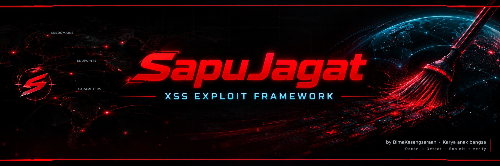

<div align="center">



# SapuJagat

### XSS Exploit Framework

**Dibuat oleh [BimaBalance](https://github.com/BimaBalance)**
*Karya anak bangsa 路 Indonesia*

<p>
  <a href="https://github.com/BimaBalance/sapujagat">
    
  </a>
  <a href="https://github.com/BimaBalance/sapujagat/blob/main/LICENSE">
    
  </a>
  
  
</p>

<p>
  <a href="https://github.com/BimaBalance/sapujagat/stargazers">
    
  </a>
  <a href="https://github.com/BimaBalance/sapujagat/network/members">
    
  </a>
  <a href="https://github.com/BimaBalance/sapujagat/issues">
    
  </a>
  <a href="https://github.com/BimaBalance/sapujagat/commits/main">
    
  </a>
</p>

**Scan with reason. Verify with evidence.**

[Mulai cepat](#-mulai-cepat) 路 [Fitur](#-fitur-utama) 路 [Dokumentasi](#-dokumentasi) 路 [Privasi](#-stats-dan-privasi) 路 [Kontribusi](#-kontribusi)

</div>

---

> [!IMPORTANT]
> SapuJagat adalah alat pengujian keamanan. Jalankan hanya pada aset milik sendiri atau aset yang secara eksplisit mengizinkan pengujian. Pengguna bertanggung jawab atas izin, ruang lingkup, dan dampak dari setiap pengujian.

## Daftar isi

<details open>
<summary><strong>Klik untuk membuka atau menutup navigasi</strong></summary>

- [Tentang SapuJagat](#tentang-sapujagat)
- [Filosofi proyek](#filosofi-proyek)
- [Mulai cepat](#-mulai-cepat)
- [Instalasi](#-instalasi)
- [Persiapan lingkungan](#persiapan-lingkungan)
- [Cara penggunaan](#-cara-penggunaan)
- [Mode pemindaian](#mode-pemindaian)
- [Fitur utama](#-fitur-utama)
- [Alur kerja](#alur-kerja)
- [Memahami hasil](#memahami-hasil)
- [Verifikasi browser](#verifikasi-browser)
- [Format laporan](#format-laporan)
- [Stats dan privasi](#-stats-dan-privasi)
- [Batasan](#-batasan)
- [Troubleshooting](#-troubleshooting)
- [Responsible disclosure](#responsible-disclosure)
- [Kontribusi](#-kontribusi)
- [Roadmap](#roadmap)
- [FAQ](#-faq)
- [Lisensi](#-lisensi)
- [Tentang pengembang](#tentang-pengembang)

</details>

---

## Tentang SapuJagat

SapuJagat adalah framework pengujian XSS berbasis Bash yang dirancang untuk membantu proses pengujian secara terstruktur. Tool ini menggabungkan pencarian kandidat, analisis konteks, variasi payload, dan verifikasi browser ketika dependensi yang dibutuhkan tersedia.

Tujuannya bukan membuat daftar temuan sepanjang mungkin. Tujuannya membantu peneliti memahami bagaimana input dipantulkan oleh aplikasi, konteks apa yang mengelilinginya, dan apakah perilaku yang ditemukan benar-benar layak diperiksa lebih lanjut.

### Ringkasan proyek

| Informasi | Detail |
| --- | --- |
| Nama | SapuJagat |
| Kategori | XSS Exploit Framework |
| Versi dokumentasi | 28.0.0 |
| Bahasa implementasi utama | Bash |
| Lingkungan | Linux dan Termux |
| Verifikasi browser | Playwright dengan Chromium, bila tersedia |
| Lisensi | MIT |
| Pengembang | BimaBalance |
| Repository | [BimaBalance/sapujagat](https://github.com/BimaBalance/sapujagat) |

### Prinsip utama

- **Context matters.** Input yang sama dapat diproses secara berbeda bergantung pada lokasi output.
- **Reflection is not proof.** String yang muncul kembali belum tentu menghasilkan eksekusi JavaScript.
- **Evidence over assumptions.** Catat request, respons, konteks, dan bukti yang dapat direproduksi.
- **Authorized testing only.** Ruang lingkup program dan izin pemilik aset selalu menjadi batas.
- **Honest reporting.** Pisahkan kandidat, hasil terverifikasi, dan hal yang belum dapat dipastikan.

### Apa yang ingin dibantu tool ini?

<details>
<summary><strong>Untuk bug hunter</strong></summary>

SapuJagat membantu mengorganisasi pemeriksaan parameter dan konteks input agar peneliti tidak hanya bergantung pada pencarian string sederhana. Hasil tetap perlu diperiksa secara manual sebelum dikirim sebagai laporan kerentanan.

</details>

<details>
<summary><strong>Untuk pentester</strong></summary>

Tool dapat menjadi bagian dari alur assessment yang telah disetujui. Tetapkan target, batas request, akun pengujian, dan kondisi penghentian sebelum memulai.

</details>

<details>
<summary><strong>Untuk pembelajaran</strong></summary>

SapuJagat dapat membantu memahami perbedaan antara reflection, encoding, konteks HTML, dan eksekusi di browser. Gunakan lab lokal atau platform latihan yang memang menyediakan izin eksplisit.

</details>

---

## Filosofi proyek

SapuJagat dibangun dengan pendekatan evidence-first. Hasil otomatis adalah petunjuk, bukan pengganti penilaian teknis.

### Alur berpikir

```text
Target berizin
      |
      v
Identifikasi input dan parameter
      |
      v
Analisis konteks output
      |
      v
Uji kandidat secara terkontrol
      |
      v
Verifikasi browser bila tersedia
      |
      v
Review bukti secara manual
      |
      v
Laporan yang dapat direproduksi
```

### Yang bukan tujuan proyek

- Bukan alat untuk menyerang target tanpa izin.
- Bukan jaminan semua XSS akan ditemukan.
- Bukan pengganti code review atau pengujian manual.
- Bukan sistem yang dapat menentukan severity secara sempurna.
- Bukan layanan cloud atau dashboard SaaS.
- Bukan aplikasi mobile dengan antarmuka grafis.
- Bukan layanan dukungan komersial.
- Bukan alat auto-patch untuk memperbaiki kode aplikasi.
- Bukan produk yang mengklaim memakai AI/ML untuk mendeteksi XSS.
- Bukan sistem telemetry yang mengirim hasil scan ke pengembang.

---

## 馃殌 Mulai cepat

### 1. Clone repository

```bash
git clone https://github.com/BimaBalance/sapujagat.git
cd sapujagat
```

### 2. Beri izin eksekusi

```bash
chmod +x sapujagat.sh
```

### 3. Lihat bantuan dari versi lokal

```bash
./sapujagat.sh --help
```

> Gunakan sintaks yang ditampilkan oleh file lokal. Opsi dapat berubah antarversi, jadi bantuan bawaan adalah referensi utama untuk argumen yang benar-benar didukung.

### 4. Jalankan self-test

Jika versi yang kamu gunakan menyediakan opsi self-test, jalankan opsi yang tertera di bantuan. Pastikan dependensi dan izin file sudah benar sebelum menguji target.

### 5. Mulai dari target lab

Gunakan aplikasi lokal, lab XSS, atau target yang secara tertulis mengizinkan pengujian. Jangan menjadikan domain publik sebagai target hanya karena dapat diakses.

<details>
<summary><strong>Checklist sebelum scan</strong></summary>

- [ ] Saya memiliki izin tertulis atau otorisasi yang jelas.
- [ ] Host dan path berada dalam scope.
- [ ] Saya memahami batas request dan kebijakan program.
- [ ] Saya tidak menggunakan akun atau data orang lain.
- [ ] Saya menyiapkan tempat penyimpanan bukti yang aman.
- [ ] Saya tahu cara menghentikan proses bila terjadi dampak tak terduga.
- [ ] Saya akan memvalidasi temuan sebelum membuat klaim.
- [ ] Saya akan menghapus data sensitif yang tidak diperlukan.

</details>

---

## 馃О Instalasi

### Persyaratan umum

SapuJagat dibuat sebagai script Bash. Lingkungan minimal perlu menyediakan Bash dan utilitas sistem yang dipakai oleh script. Fitur tertentu memerlukan dependensi tambahan.

| Komponen | Kegunaan |
| --- | --- |
| Bash | Menjalankan script utama |
| Git | Mengambil repository dan pembaruan |
| curl | Request HTTP dan pengambilan data yang didukung |
| Python 3 | Mendukung utilitas atau proses tambahan tertentu |
| Node.js / npm | Menyiapkan Playwright jika alur lokal memerlukannya |
| Playwright | Otomasi dan verifikasi browser |
| Chromium | Browser headless untuk pengujian yang didukung |
| jq | Membantu pemrosesan JSON bila dipakai oleh alur terkait |

Daftar di atas adalah panduan lingkungan. Periksa bantuan dan pesan dependensi dari versi yang kamu gunakan untuk memastikan kebutuhan aktual.

### Linux: Debian, Ubuntu, Kali

```bash
sudo apt update
sudo apt install -y git curl jq python3 nodejs npm
git clone https://github.com/BimaBalance/sapujagat.git
cd sapujagat
chmod +x sapujagat.sh
```

### Termux

<details>
<summary><strong>Langkah instalasi di Termux</strong></summary>

Perbarui paket terlebih dahulu:

```bash
pkg update
pkg upgrade
pkg install git curl jq python
```

Clone repository:

```bash
git clone https://github.com/BimaBalance/sapujagat.git
cd sapujagat
chmod +x sapujagat.sh
```

Lalu cek bantuan:

```bash
./sapujagat.sh --help
```

Tidak semua fitur browser dapat berjalan dengan cara yang sama pada Termux. Jika verifikasi Chromium tidak tersedia, gunakan lingkungan Linux yang kompatibel atau tandai hasil sebagai belum diverifikasi.

</details>

### Lingkungan proot Linux di Android

<details>
<summary><strong>Jika memakai Ubuntu/Debian melalui proot</strong></summary>

1. Pastikan distro berhasil masuk dan paket dapat dipasang.
2. Pasang Bash, Git, curl, dan dependensi dasar.
3. Clone repository di dalam lingkungan distro.
4. Jalankan bantuan dan self-test jika tersedia.
5. Uji fitur browser secara terpisah sebelum mengandalkannya.

Lingkungan proot tidak otomatis menyediakan semua kemampuan browser desktop. Kendala sandbox, library sistem, dan penggunaan memori dapat memengaruhi verifikasi.

</details>

### Memasang Playwright

Verifikasi browser bergantung pada konfigurasi Playwright dan browser yang kompatibel. Ikuti instruksi instalasi resmi Playwright untuk sistem yang digunakan.

- Dokumentasi: [playwright.dev](https://playwright.dev/)
- Gunakan versi yang kompatibel dengan runtime.
- Pastikan Chromium dapat dijalankan oleh pengguna yang mengeksekusi script.
- Jangan menganggap proses verifikasi berhasil hanya karena dependensi terpasang.
- Periksa log bila browser gagal dimulai.

### Memeriksa instalasi

```bash
bash --version
git --version
curl --version
python3 --version
node --version
npm --version
```

Perintah pemeriksaan hanya menampilkan versi perangkat lunak. Jika satu program tidak terpasang, output akan menunjukkan bahwa dependensi tersebut tidak tersedia.

---

## 鈿欙笍 Cara penggunaan

SapuJagat memiliki mode penggunaan berdasarkan URL, domain, atau daftar target. Bentuk argumen lengkap dapat berbeda antarversi, jadi gunakan `--help` untuk memastikan sintaks yang berlaku.

### Mode URL

Mode ini ditujukan untuk memeriksa satu URL yang memang masuk scope. Sertakan hanya URL pengujian yang telah diotorisasi.

```bash
./sapujagat.sh --help
```

Cari contoh penggunaan URL pada output bantuan, lalu gunakan format tersebut pada target lab yang diizinkan.

### Mode domain

Mode domain dapat digunakan ketika kamu memiliki izin untuk menguji domain dan subdomain tertentu. Pastikan aturan program memperbolehkan enumerasi dan request otomatis.

Sebelum menjalankan mode domain:

1. Pastikan domain tercantum dalam scope.
2. Periksa apakah subdomain pihak ketiga dikecualikan.
3. Tetapkan rate limit yang sesuai.
4. Hindari endpoint produksi yang dapat mengubah data.
5. Simpan daftar aset yang diizinkan.

### Mode daftar target

Mode list berguna ketika beberapa target lab atau host yang telah disetujui perlu diperiksa. Tinjau isi file sebelum digunakan.

Contoh membuat file target lab:

```text
https://lab.example.test/search?q=test
https://staging.example.test/catalog?item=1
```

`example.test` digunakan sebagai contoh dokumentasi. Ganti hanya dengan URL yang benar-benar kamu berwenang uji.

### Dry-run

Versi yang mendukung dry-run dapat membantu memeriksa rencana eksekusi tanpa melakukan seluruh aktivitas pengujian. Lihat opsi yang disediakan oleh `--help` pada versi lokal sebelum menggunakannya.

Dry-run bukan bukti bahwa target aman, bukan validasi scope otomatis, dan bukan pengganti review manual terhadap konfigurasi.

### Menghentikan proses

Jika proses menimbulkan beban tak terduga atau keluar dari scope, hentikan proses dari terminal dan jangan lanjutkan request. Simpan log yang relevan untuk analisis, tanpa menyimpan rahasia yang tidak diperlukan.

---

## Mode pemindaian

<details>
<summary><strong>Mode 1 鈥� URL tunggal</strong></summary>

Cocok untuk memeriksa parameter pada satu endpoint yang telah diizinkan.

**Gunakan saat:**
- Endpoint dan parameter sudah diketahui.
- Kamu sedang mereproduksi temuan tertentu.
- Kamu ingin mengurangi variabel saat troubleshooting.

**Perhatikan:**
- URL dapat berisi token atau data pribadi.
- Jangan menaruh kredensial di command history.
- Gunakan akun pengujian yang disediakan pemilik sistem.
- Hindari parameter yang mengubah atau menghapus data.

</details>

<details>
<summary><strong>Mode 2 鈥� Domain dalam scope</strong></summary>

Cocok untuk pemetaan awal pada aset yang tercantum di dokumen otorisasi.

**Gunakan saat:**
- Scope program memperbolehkan pemeriksaan domain.
- Kamu memahami batas subdomain.
- Rate limit sudah ditentukan.
- Kamu dapat memonitor request yang dikirim.

**Perhatikan:**
- Hasil enumerasi tidak otomatis berarti semua host boleh diuji.
- Host pihak ketiga dapat berada di luar scope.
- Data historis bisa mengandung URL lama atau tidak aktif.
- Hentikan pemeriksaan jika ada dampak operasional.

</details>

<details>
<summary><strong>Mode 3 鈥� File daftar target</strong></summary>

Cocok untuk daftar endpoint atau lab yang sudah direview.

**Gunakan saat:**
- Daftar target telah diperiksa manual.
- Duplikasi sudah dikurangi.
- Target memiliki status izin yang jelas.
- Hasil perlu dibandingkan dalam satu sesi.

**Perhatikan:**
- Satu URL dalam file tidak membuktikan izin.
- File target harus disimpan secara aman.
- Hapus parameter sensitif sebelum berbagi file.
- Jangan memasukkan daftar target milik pihak lain tanpa otorisasi.

</details>

---

## 馃敩 Fitur utama

### 1. Context-aware detection

SapuJagat dirancang untuk mempertimbangkan konteks tempat input muncul, bukan hanya mencari string yang dipantulkan.

| Konteks | Gambaran |
| --- | --- |
| Body | Nilai muncul di area konten HTML |
| Attribute, double quote | Nilai muncul di atribut yang memakai tanda kutip ganda |
| Attribute, single quote | Nilai muncul di atribut yang memakai tanda kutip tunggal |
| Unquoted attribute | Nilai berada di atribut tanpa tanda kutip |
| Script | Nilai muncul dalam konteks elemen script |
| Href | Nilai muncul pada atribut atau konteks tautan |
| Src | Nilai muncul pada atribut atau konteks sumber |
| RCDATA | Nilai muncul pada area seperti textarea atau title |
| Comment | Nilai muncul di dalam komentar HTML |
| Style | Nilai muncul di konteks CSS atau elemen style |

Klasifikasi konteks membantu menentukan pemeriksaan lanjutan. Ia tidak membuktikan bahwa sebuah payload dapat dieksekusi di semua browser atau konfigurasi.

### 2. Kumpulan payload

Proyek ini menyediakan ratusan payload yang dikelompokkan ke dalam beberapa kategori. Payload adalah kandidat uji; efektivitasnya bergantung pada konteks, filter, browser, dan logika aplikasi.

Gunakan payload pada lab dan aset yang diizinkan. Hindari payload yang mengirim data keluar, mengubah state, atau mengganggu pengguna nyata kecuali skenario tersebut secara eksplisit disetujui dan dikendalikan.

### 3. Mutasi payload

Variasi yang disebutkan dalam spesifikasi proyek mencakup:

- URL encoding.
- Double URL encoding.
- Perubahan kapitalisasi.
- Representasi Base64.
- Bentuk `fromCharCode`.
- Variasi pemisahan tag.

Mutasi membantu menguji bagaimana aplikasi menangani representasi input yang berbeda. Mutasi bukan metode untuk melewati semua pertahanan, dan hasilnya tetap harus dibaca sesuai konteks.

### 4. Filter probe

Probe filter digunakan untuk mengamati bagaimana token tertentu diproses oleh aplikasi. Perbedaan respons dapat membantu mengidentifikasi normalisasi, encoding, atau pemblokiran yang perlu dianalisis lebih lanjut.

Jangan menyimpulkan bahwa suatu filter aman atau rentan hanya berdasarkan satu token. Periksa konteks output, urutan transformasi, dan perilaku browser.

### 5. Verifikasi browser

Jika Playwright dan Chromium tersedia, alur verifikasi dapat membantu memeriksa apakah kandidat menghasilkan perilaku yang teramati di browser. Pemeriksaan dapat mencakup event dialog dan bukti screenshot sesuai implementasi.

Hasil verifikasi browser tetap memiliki batas. Perbedaan versi browser, autentikasi, CSP, jaringan, dan kondisi halaman dapat mengubah hasil.

### 6. Sumber crawling

Spesifikasi proyek menyebut dukungan pengumpulan URL dari beberapa sumber, termasuk sitemap, Wayback, gau, ParamSpider, dan Katana. Ketersediaan aktual bergantung pada dependensi, konfigurasi, serta opsi yang didukung versi lokal.

Sumber URL dapat menghasilkan duplikasi, endpoint lama, atau aset yang tidak masuk scope. Review daftar URL sebelum menjalankan pengujian lanjutan.

### 7. Payload dampak

Proyek menyebut kategori demonstrasi dampak seperti akses cookie, interaksi keyboard, pengalihan form, pemeriksaan metadata, dan WebRTC. Fitur seperti ini berpotensi menyentuh data sensitif.

Gunakan hanya pada lingkungan uji yang terkendali dengan data dummy. Jangan mengaktifkan pengumpulan data pengguna nyata, kredensial, atau informasi perangkat tanpa otorisasi eksplisit.

### 8. Chain dan korelasi

Spesifikasi juga menyebut pemeriksaan lanjutan seperti replay cookie, decoding JWT, deteksi pola kredensial cloud, indikator admin, dan callback blind menggunakan Interactsh.

Fitur ini tidak boleh dianggap sebagai izin untuk mengakses akun, cloud, atau sistem lain. Jangan menggunakan secret sungguhan untuk pembuktian dampak. Gunakan token uji dan bukti minimal yang disetujui.

### 9. Laporan

Output yang disebutkan dalam spesifikasi meliputi HTML, JSON, Markdown, dan skrip PoC per temuan. Bentuk dan kelengkapan output dapat bergantung pada opsi yang tersedia di versi lokal.

Sebelum membagikan laporan, hapus token, cookie, data pribadi, alamat internal, dan informasi lain yang tidak diperlukan penerima.

### 10. Self-test

Self-test dapat membantu memeriksa bagian tertentu dari tool sebelum penggunaan. Ia bukan sertifikasi bahwa seluruh fitur bekerja atau bahwa hasil scan selalu benar.

Jalankan self-test setelah instalasi atau perubahan dependensi jika opsi tersebut tersedia.

### 11. Dry-run

Dry-run membantu memahami rencana kerja tanpa menjalankan semua aktivitas pengujian yang sebenarnya, bila didukung versi lokal.

Tetap periksa target dan konfigurasi. Jangan berasumsi dry-run memvalidasi otorisasi.

### 12. Stats

Perintah `--stats` pada spesifikasi proyek menampilkan metrik publik repository GitHub dan counter lokal. Lihat bagian [Stats dan privasi](#-stats-dan-privasi) untuk detail.

---

## Alur kerja

### Tahap 1 鈥� Tetapkan otorisasi

Dokumentasikan siapa pemilik aset, tujuan pengujian, periode izin, batas request, akun uji, dan kondisi penghentian.

### Tahap 2 鈥� Tinjau target

Pastikan setiap URL sesuai scope. Periksa redirect, host tujuan, subdomain, dan endpoint pihak ketiga sebelum pengujian lebih jauh.

### Tahap 3 鈥� Pahami input

Catat parameter, tipe input, autentikasi yang diperlukan, dan apakah endpoint mengubah state. Hindari data pribadi atau rahasia yang tidak dibutuhkan.

### Tahap 4 鈥� Lakukan pemeriksaan terkontrol

Gunakan rate limit yang wajar. Pantau status respons dan beban layanan. Hentikan jika aplikasi menjadi tidak stabil.

### Tahap 5 鈥� Tinjau konteks

Jangan hanya mengandalkan hasil pencarian string. Periksa apakah input muncul dalam teks, atribut, JavaScript, URL, CSS, atau konteks lainnya.

### Tahap 6 鈥� Verifikasi

Jika browser verification tersedia, gunakan hasilnya sebagai satu bagian bukti. Jika tidak tersedia, nyatakan dengan jujur bahwa kandidat belum diverifikasi oleh browser.

### Tahap 7 鈥� Reproduksi secara manual

Coba ulang dengan kondisi yang sama dan gunakan akun uji. Pastikan perilaku bukan hasil cache, extension, atau kondisi lokal yang tidak relevan.

### Tahap 8 鈥� Buat laporan

Sertakan langkah reproduksi, request dan response yang sudah disanitasi, dampak realistis, bukti minimal, dan rekomendasi mitigasi.

### Tahap 9 鈥� Hapus data sementara

Simpan hanya bukti yang dibutuhkan. Hapus token dan file sementara sesuai kebijakan program atau organisasi.

---

## Memahami hasil

### Reflection vs XSS

| Temuan | Artinya | Tindakan |
| --- | --- | --- |
| Input tidak muncul | Belum ada reflection yang terlihat | Periksa encoding, alur input, dan batas pengujian |
| Input muncul sebagai teks | Reflection teramati, belum tentu berbahaya | Periksa konteks dan encoding |
| Input muncul dalam atribut | Perlu analisis batas atribut dan encoding | Review DOM dan respons |
| Input muncul dalam script | Perlu analisis konteks JavaScript | Periksa escaping dan cara nilai dipakai |
| Dialog terpicu pada browser uji | Indikasi eksekusi yang lebih kuat | Simpan bukti minimal dan reproduksi |
| Kandidat tidak dapat diverifikasi | Bukti belum cukup | Jangan klaim sebagai confirmed XSS |

### Tingkat keyakinan

Hindari menggunakan label 鈥渃onfirmed鈥� hanya karena tool mencetak sebuah kandidat. Penilaian akhir harus mempertimbangkan bukti yang benar-benar tersedia.

<details>
<summary><strong>Kandidat</strong></summary>

Ada sinyal yang layak diperiksa, tetapi belum ada bukti cukup bahwa JavaScript dieksekusi dengan dampak yang relevan.

</details>

<details>
<summary><strong>Perlu review manual</strong></summary>

Ada reflection atau perilaku tidak biasa. Peneliti perlu memeriksa konteks, encoding, browser, dan kemungkinan false positive.

</details>

<details>
<summary><strong>Terverifikasi pada lingkungan uji</strong></summary>

Perilaku berhasil direproduksi dalam lingkungan dan kondisi yang terdokumentasi. Catat versi browser, akun uji, URL, dan bukti yang relevan.

</details>

### Contoh ringkasan temuan

```text
Judul:
Reflected XSS pada parameter pencarian

Aset:
Endpoint yang telah disetujui dalam scope

Parameter:
q

Bukti:
Input terpantul pada konteks yang dijelaskan dalam laporan

Verifikasi:
Catat apakah eksekusi browser berhasil atau belum diverifikasi

Dampak:
Jelaskan dampak realistis berdasarkan konteks aplikasi

Mitigasi:
Gunakan encoding sesuai konteks dan hindari memasukkan input
yang tidak tepercaya ke sink berbahaya.
```

Contoh di atas adalah kerangka dokumentasi, bukan klaim bahwa kerentanan tersebut ditemukan pada suatu target.

---

## Verifikasi browser

### Mengapa verifikasi penting?

Respons HTTP yang memuat input tidak otomatis berarti browser akan mengeksekusi input itu. Browser memproses HTML, JavaScript, URL, dan kebijakan keamanan berdasarkan konteks.

Verifikasi browser dapat menambah keyakinan, tetapi tidak menghapus kebutuhan untuk memahami alur data dan dampak sebenarnya.

### Hal yang perlu dicatat

- Versi browser yang digunakan.
- Apakah halaman membutuhkan login.
- Apakah request mengandalkan session tertentu.
- Apakah CSP atau kebijakan lain memengaruhi hasil.
- Apakah dialog atau perilaku teramati benar-benar berasal dari input uji.
- Apakah screenshot tidak memuat data sensitif.
- Apakah hasil dapat direproduksi.

### Jika browser verification tidak tersedia

Jangan menyamakan 鈥渢idak dapat diverifikasi鈥� dengan 鈥渁man鈥� atau 鈥渞entan鈥�. Laporkan statusnya sebagai belum terverifikasi dan jelaskan keterbatasan lingkungan.

### Screenshot sebagai bukti

Screenshot membantu menjelaskan perilaku visual, tetapi tidak selalu membuktikan penyebabnya. Lengkapi dengan langkah reproduksi dan konteks teknis yang aman dibagikan.

---

## Format laporan

### HTML

Laporan HTML dapat membantu membaca ringkasan temuan dan bukti secara visual. Buka file secara lokal dan periksa apakah ada informasi sensitif sebelum dibagikan.

### JSON

JSON cocok untuk pemrosesan lanjutan atau integrasi dengan workflow internal. Periksa skema dan field aktual dari output versi yang kamu gunakan.

### Markdown

Markdown praktis untuk review di GitHub, GitLab, atau sistem tiket internal. Jangan mengunggah bukti sensitif ke repository publik.

### PoC script

PoC sebaiknya minimal, dapat direproduksi, dan tidak melakukan tindakan di luar pembuktian yang diperlukan. Jangan memasukkan token atau data produksi ke dalam skrip yang akan dibagikan.

### Checklist sebelum mengirim laporan

- [ ] Judul menjelaskan jenis dan lokasi masalah.
- [ ] Aset benar-benar termasuk scope.
- [ ] Langkah reproduksi dapat diikuti.
- [ ] Bukti tidak berisi data pribadi yang tidak relevan.
- [ ] Dampak dijelaskan tanpa melebih-lebihkan.
- [ ] Severity disertai alasan.
- [ ] Mitigasi sesuai akar masalah.
- [ ] Duplikasi dan temuan sebelumnya telah diperiksa.
- [ ] Status verifikasi dijelaskan secara akurat.
- [ ] Informasi rahasia telah disanitasi.

---

## 馃搳 Stats dan privasi

Spesifikasi proyek menyebut opsi `--stats` untuk menampilkan metrik publik repository GitHub, seperti stars, forks, watchers, issues, commit terakhir, dan lisensi.

### Data yang diambil

| Data | Sumber | Keterangan |
| --- | --- | --- |
| Stars | GitHub API publik | Metrik repository |
| Forks | GitHub API publik | Metrik repository |
| Watchers | GitHub API publik | Metrik repository |
| Issues | GitHub API publik | Jumlah issue yang terlihat |
| Commit terakhir | GitHub API publik | Informasi aktivitas repository |
| Lisensi | GitHub API publik | Lisensi repository |
| Counter lokal | File lokal pengguna | Jumlah scan yang tercatat oleh tool |

### Privasi lokal

Berdasarkan spesifikasi proyek, counter lokal disimpan pada:

```text
~/.sapujagat/stats.json
```

Counter lokal digunakan untuk statistik pada perangkat dan tidak dikirim ke pengembang. Metrik repository yang diminta dari GitHub berasal dari endpoint publik GitHub.

### Yang tidak diklaim

- Tidak ada klaim bahwa semua aktivitas perangkat dipantau.
- Tidak ada klaim bahwa hasil scan dikirim ke server pengembang.
- Tidak ada klaim bahwa tool mengirim telemetry atau melakukan phone-home.
- Tidak ada klaim bahwa statistik lokal adalah metrik penggunaan global.

### Periksa sendiri

Untuk audit, periksa kode yang berjalan pada versi repository yang kamu clone. Jangan hanya mengandalkan README saat mengevaluasi perilaku jaringan atau penyimpanan lokal.

Repository: [github.com/BimaBalance/sapujagat](https://github.com/BimaBalance/sapujagat)

---

## 馃攼 Batasan

SapuJagat tidak menjamin semua variasi XSS akan ditemukan. Hasil sangat dipengaruhi oleh struktur aplikasi, autentikasi, encoding, browser, kebijakan keamanan, dan kondisi jaringan.

### Batasan teknis

- Aplikasi dengan alur JavaScript kompleks dapat memerlukan analisis manual.
- Konten yang dirender secara dinamis dapat berubah setelah pemindaian.
- WAF dan rate limit dapat memengaruhi respons.
- Endpoint yang memerlukan autentikasi mungkin tidak dapat diperiksa tanpa konfigurasi yang sesuai.
- URL historis bisa sudah tidak berlaku.
- Crawling dapat menemukan URL yang berada di luar scope.
- Browser headless tidak selalu identik dengan browser pengguna akhir.
- Screenshot tidak selalu cukup sebagai bukti.
- Mutasi payload tidak menjamin filter dapat dilewati.
- Hasil otomatis dapat berupa false positive atau false negative.

### Batasan operasional

- Linux dan Termux memiliki karakteristik lingkungan berbeda.
- Perangkat dengan RAM terbatas mungkin kesulitan menjalankan browser headless.
- Beberapa sumber crawling memerlukan dependensi tambahan.
- Koneksi internet yang tidak stabil dapat menghasilkan hasil parsial.
- Versi dependensi dapat mengubah perilaku.
- Perubahan aplikasi target dapat membuat temuan tidak dapat direproduksi.
- Pengujian yang terlalu agresif dapat mengganggu layanan.
- Tool tidak menggantikan izin pemilik aset.

### Batasan produk

| Area | Status |
| --- | --- |
| GUI / dashboard web | Tidak tersedia |
| Aplikasi Android native | Tidak tersedia |
| Layanan cloud | Tidak tersedia |
| Dukungan komersial | Tidak tersedia |
| Auto-patch kode aplikasi | Tidak tersedia |
| AI/ML detection | Tidak diklaim |
| Telemetry ke pengembang | Tidak diklaim; periksa kode versi lokal |
| Framework Bash | Ya |
| Output laporan | HTML, JSON, Markdown, dan PoC sesuai implementasi |
| Verifikasi browser | Bergantung pada Playwright dan Chromium |

---

## 馃洜 Troubleshooting

<details>
<summary><strong>Permission denied</strong></summary>

Cek izin file:

```bash
chmod +x sapujagat.sh
```

Jalankan kembali dari direktori repository. Jika masih gagal, periksa permission direktori dan lokasi file.

</details>

<details>
<summary><strong>Command not found</strong></summary>

Pastikan dependensi yang diperlukan sudah terpasang dan tersedia di `PATH`.

```bash
command -v bash
command -v curl
command -v python3
command -v node
```

Tidak semua fitur membutuhkan semua dependensi. Cocokkan pesan error dengan fitur yang sedang dijalankan.

</details>

<details>
<summary><strong>Playwright atau Chromium gagal dimulai</strong></summary>

- Pastikan Playwright terpasang pada runtime yang benar.
- Pastikan browser yang sesuai tersedia.
- Periksa library sistem yang dibutuhkan Chromium.
- Periksa izin eksekusi dan ruang penyimpanan.
- Coba lingkungan Linux yang kompatibel bila Termux membatasi fitur browser.

Jangan menyatakan temuan telah diverifikasi browser jika browser gagal berjalan.

</details>

<details>
<summary><strong>Hasil scan kosong</strong></summary>

Hasil kosong tidak membuktikan target bebas XSS. Periksa scope, parameter, autentikasi, format URL, konektivitas, dan pesan error. Uji dulu pada lab yang diketahui memiliki perilaku yang bisa direproduksi.

</details>

<details>
<summary><strong>Terlalu banyak hasil</strong></summary>

Kelompokkan hasil berdasarkan endpoint, parameter, konteks, dan bukti. Hapus duplikasi setelah memastikan dua temuan memang memiliki akar masalah yang sama. Jangan menghapus hasil hanya karena terlihat mirip tanpa memeriksa bukti.

</details>

<details>
<summary><strong>False positive</strong></summary>

Periksa apakah input hanya muncul sebagai teks, apakah encoding sudah benar, dan apakah browser benar-benar menjalankan perilaku yang diuji. Simpan alasan mengapa kandidat ditolak agar review berikutnya lebih konsisten.

</details>

<details>
<summary><strong>Request timeout</strong></summary>

Periksa koneksi, status layanan, dan batas request. Kurangi beban sesuai kebijakan program. Jangan meningkatkan concurrency secara agresif untuk mengatasi timeout.

</details>

<details>
<summary><strong>Stats tidak bisa diambil</strong></summary>

Perintah stats yang meminta GitHub API publik memerlukan koneksi jaringan. Jika GitHub API tidak dapat diakses, metrik dapat gagal dimuat atau tidak diperbarui. Coba lagi nanti dan jangan menafsirkan kegagalan sebagai angka nol.

</details>

<details>
<summary><strong>Output laporan tidak ditemukan</strong></summary>

Periksa pesan akhir proses dan direktori kerja saat perintah dijalankan. Gunakan bantuan versi lokal untuk mengetahui opsi output yang didukung. Hindari mengasumsikan nama file jika tool tidak menampilkannya.

</details>

<details>
<summary><strong>Termux kehabisan memori</strong></summary>

- Tutup aplikasi lain yang tidak diperlukan.
- Gunakan daftar target kecil.
- Hindari menjalankan beberapa proses berat bersamaan.
- Pertimbangkan Linux desktop atau VM untuk verifikasi browser.
- Simpan bukti yang relevan dan hentikan proses jika perangkat terlalu panas.

</details>

<details>
<summary><strong>Repository tidak dapat di-clone</strong></summary>

Pastikan URL repository benar dan koneksi GitHub tersedia.

```bash
git ls-remote https://github.com/BimaBalance/sapujagat.git
```

Jika gagal, periksa koneksi, DNS, proxy, dan status layanan GitHub.

</details>

---

## Responsible disclosure

SapuJagat ditujukan untuk penggunaan yang sah dan terotorisasi.

### Sebelum menguji

1. Baca kebijakan keamanan target.
2. Pastikan aset dan jenis pengujian masuk scope.
3. Ikuti batas rate, waktu, dan akun.
4. Jangan mengakses data yang bukan milikmu.
5. Jangan melakukan perubahan atau penghapusan data.
6. Hentikan pengujian jika terjadi gangguan.
7. Simpan bukti secukupnya.

### Saat menemukan masalah

- Jangan mengeksploitasi lebih jauh dari yang dibutuhkan untuk membuktikan masalah.
- Jangan mengunduh kumpulan data sensitif.
- Jangan menyimpan token atau kredensial yang tidak diperlukan.
- Jangan mempublikasikan detail sebelum koordinasi dengan pemilik sistem.
- Laporkan melalui kanal resmi yang ditetapkan program.
- Ikuti instruksi triage dan disclosure dari pemilik aset.

### Prinsip minimisasi bukti

Bukti yang baik menunjukkan masalah dengan risiko tambahan sekecil mungkin. Gunakan akun uji, data dummy, dan payload yang tidak mengekfiltrasi data. Bila demonstrasi berdampak tinggi diperlukan, koordinasikan skenario dengan pemilik aset terlebih dahulu.

---

## 馃И Pengujian dan validasi proyek

Bagian ini adalah checklist umum untuk menjaga kualitas perubahan pada repository. Jalankan hanya pengujian yang benar-benar tersedia dalam versi lokal.

### Pemeriksaan dasar

- [ ] Script dapat dibaca oleh Bash.
- [ ] Bantuan menampilkan opsi yang didukung.
- [ ] Self-test berjalan jika tersedia.
- [ ] Error ditangani dengan pesan yang jelas.
- [ ] File output tidak menimpa bukti penting secara tidak sengaja.
- [ ] Tidak ada secret yang ikut masuk ke repository.
- [ ] Dokumentasi sesuai perilaku kode saat ini.
- [ ] Contoh command sudah diuji sebelum dipublikasikan.

### Pemeriksaan kualitas temuan

- [ ] Kandidat tidak langsung dianggap sebagai confirmed.
- [ ] Konteks input dicatat.
- [ ] Bukti browser disimpan bila tersedia.
- [ ] False positive ditandai.
- [ ] URL di luar scope dikeluarkan.
- [ ] Data sensitif disanitasi.
- [ ] Severity memiliki justifikasi.
- [ ] Temuan dapat direproduksi secara aman.

### Sebelum merilis versi

- [ ] Perbarui nomor versi.
- [ ] Tinjau perubahan pada `--help`.
- [ ] Perbarui bagian README yang berubah.
- [ ] Periksa lisensi dan atribusi dependensi.
- [ ] Jalankan test yang tersedia.
- [ ] Pastikan tidak ada credential atau token dalam commit.
- [ ] Tulis catatan perubahan yang jujur.
- [ ] Uji clone bersih dari repository.
- [ ] Pastikan petunjuk instalasi masih sesuai.
- [ ] Review diff sebelum membuat release.

---

## 馃摝 Struktur repository

Struktur berikut adalah gambaran sederhana dari file utama yang disebut dalam dokumentasi. File tambahan dapat berubah seiring perkembangan proyek.

```text
sapujagat/
鈹溾攢鈹� banner.png
鈹溾攢鈹� sapujagat.sh
鈹溾攢鈹� README.md
鈹溾攢鈹� LICENSE
鈹斺攢鈹� ...
```

| File | Peran |
| --- | --- |
| `banner.png` | Banner visual repository |
| `sapujagat.sh` | Script utama |
| `README.md` | Dokumentasi proyek |
| `LICENSE` | Ketentuan lisensi |

Jika struktur aktual berbeda, gunakan tampilan repository sebagai sumber yang paling akurat.

---


---

<div align="center">

**SapuJagat 路 BimaBalance 路 Karya anak bangsa**

[Repository](https://github.com/BimaBalance/sapujagat) 路 [Issues](https://github.com/BimaBalance/sapujagat/issues) 路 [Profil GitHub](https://github.com/BimaBalance)

</div>

---

## Lampiran M 鈥� Panduan memilih bukti yang tepat

Bukti yang efektif menjawab satu pertanyaan teknis dengan risiko minimum. Kumpulkan bukti secukupnya agar reviewer dapat memahami temuan tanpa memperoleh akses ke data yang tidak diperlukan.

### Bukti untuk setiap jenis klaim

| Klaim | Bukti yang relevan | Hindari |
| --- | --- | --- |
| Input terpantul | Respons tersanitasi dan konteks output | Menyebutnya XSS hanya dari string |
| Perilaku browser | Langkah reproduksi dan bukti browser | Screenshot tanpa konteks |
| Dampak pada sesi | Demonstrasi dengan akun uji | Cookie aktif milik pengguna |
| Masalah pada URL | URL tersanitasi dan perilaku navigasi | Membagikan token dalam query |
| Perilaku tersimpan | Alur input dan output pada akun uji | Mengubah konten pengguna nyata |
| Hasil negatif | Kondisi pengujian yang dicatat | Mengklaim aplikasi aman sepenuhnya |

### Catatan untuk reviewer

- Tunjukkan satu alur yang jelas, bukan kumpulan screenshot tanpa penjelasan.
- Jelaskan bagian yang telah disamarkan.
- Catat bila ada dependensi yang tidak tersedia.
- Jelaskan jika temuan hanya dapat direproduksi pada konfigurasi tertentu.
- Pisahkan bukti dari interpretasi peneliti.
- Gunakan istilah 鈥渋ndikasi鈥� jika bukti belum cukup untuk kesimpulan kuat.

---

## Lampiran N 鈥� Rencana pengujian regresi

Rencana regresi membantu memeriksa apakah perubahan pada tool mengubah perilaku yang sebelumnya telah dipahami. Jalankan pengujian hanya pada fixture lokal atau target lab.

### Skenario regresi dokumentasi

- [ ] Bantuan CLI tetap terbaca.
- [ ] Contoh instalasi tidak menggunakan opsi yang sudah dihapus.
- [ ] Tautan internal README mengarah ke heading yang benar.
- [ ] Badge menggunakan URL repository yang tepat.
- [ ] Nama versi konsisten.
- [ ] Perintah yang dicontohkan sesuai implementasi.
- [ ] Fitur opsional diberi catatan dependensi.
- [ ] Batasan tidak disembunyikan di bagian akhir saja.

### Skenario regresi pemrosesan

- [ ] Input kosong ditangani dengan aman.
- [ ] Input dengan karakter khusus tidak merusak output laporan.
- [ ] URL tidak valid menghasilkan pesan yang jelas.
- [ ] Kegagalan jaringan tidak ditulis sebagai hasil scan bersih.
- [ ] Timeout dilaporkan sebagai hasil tidak lengkap.
- [ ] Kegagalan browser tidak diberi status terverifikasi.
- [ ] Output lama tidak tertimpa tanpa peringatan yang sesuai.
- [ ] Data sensitif tidak ditulis ke log secara tidak sengaja.

### Skenario regresi privasi

- [ ] Counter lokal tetap berada pada lokasi lokal yang didokumentasikan.
- [ ] Fitur stats hanya meminta data yang dijelaskan.
- [ ] Log tidak menyertakan credential secara default.
- [ ] Tidak ada token uji yang ikut dalam commit.
- [ ] File sementara ditangani sesuai alur yang diharapkan.
- [ ] README tidak menjanjikan perilaku privasi yang belum diaudit.

---

## Lampiran O 鈥� Panduan membuat demo yang aman

Demo yang baik menunjukkan kemampuan teknis tanpa membuat orang lain menjadi target uji. Pilih lingkungan yang memang dibuat untuk latihan, atau aplikasi lokal yang kamu kendalikan.

### Sebelum demo

1. Siapkan aplikasi latihan yang terisolasi.
2. Gunakan data dummy.
3. Nonaktifkan integrasi ke sistem produksi.
4. Periksa apakah browser dan dependensi berjalan.
5. Tentukan hasil yang ingin diperlihatkan.
6. Siapkan cara menghentikan proses.
7. Hindari token yang dapat dipakai ulang.
8. Pastikan rekaman layar tidak memuat informasi pribadi.

### Saat demo

- Jelaskan perbedaan reflection dan eksekusi.
- Tunjukkan konteks output.
- Jelaskan batasan hasil otomatis.
- Hindari klaim 鈥渂ypass semua filter鈥�.
- Jangan memperlihatkan data rahasia untuk membuat demo terlihat dramatis.
- Beri label jelas jika output merupakan contoh sintetis.
- Simpan log secukupnya untuk pembelajaran.

### Setelah demo

- Hapus kredensial dan data sementara.
- Reset aplikasi latihan bila diperlukan.
- Periksa kembali file rekaman sebelum membagikan.
- Jelaskan bahwa demo tidak membuktikan kerentanan pada layanan lain.
- Cantumkan versi tool dan lingkungan pengujian.

---

## Lampiran P 鈥� Panduan membaca perubahan kode

Sebelum menerima perubahan pada tool keamanan, pahami dampak perubahan terhadap request, penyimpanan, proses eksternal, dan laporan.

### Area yang perlu ditinjau

| Area | Pertanyaan review |
| --- | --- |
| Input CLI | Apakah argumen diparse dengan benar? |
| Validasi target | Apakah URL dan host diperlakukan secara konsisten? |
| HTTP client | Apakah timeout dan batas request masuk akal? |
| Proses eksternal | Apakah command dijalankan dengan argumen yang aman? |
| File output | Apakah path dan nama file ditangani dengan benar? |
| Error handling | Apakah error dibedakan dari hasil negatif? |
| Browser runner | Apakah proses dibersihkan setelah selesai? |
| Laporan | Apakah bukti disanitasi dan konteks dicatat? |
| Stats | Apakah data lokal dan data publik dipisahkan? |
| Dokumentasi | Apakah klaim sesuai dengan kode? |

### Saat menemukan perubahan berisiko

- Tunda merge sampai tujuan perubahan jelas.
- Buat reproduksi pada lab.
- Jangan jalankan perubahan yang belum dipahami terhadap target publik.
- Periksa efek samping pada file lokal.
- Catat alasan menerima atau menolak perubahan.
- Jika ada ketidakpastian, minta review tambahan.

---

## Lampiran Q 鈥� Standar penamaan dan pengorganisasian catatan

Nama file sebaiknya konsisten, mudah dicari, dan tidak membocorkan data sensitif.

### Pola nama yang disarankan

```text
YYYY-MM-DD-project-area-type.ext
```

Contoh:

```text
2026-10-17-lab-xss-notes.md
2026-10-17-lab-xss-response-redacted.txt
2026-10-17-lab-xss-evidence.png
2026-10-17-lab-xss-report-draft.md
```

### Praktik pengelolaan

- Pisahkan file bukti dari file konfigurasi.
- Batasi permission direktori bukti.
- Hindari memakai nama pengguna nyata sebagai nama file.
- Jangan mengunggah file bukti ke repository publik secara default.
- Gunakan backup yang sesuai kebijakan.
- Hapus file duplikat setelah memeriksa kebutuhan audit.
- Dokumentasikan sumber dan tujuan file.
- Jangan menaruh secret dalam metadata atau nama file.

---

## Lampiran R 鈥� Prinsip komunikasi temuan

Laporan keamanan perlu membantu pemilik sistem mengambil tindakan. Bahasa yang jelas dan netral biasanya lebih efektif daripada istilah dramatis.

### Gunakan

- 鈥淚nput terpantul pada konteks atribut.鈥�
- 鈥淓ksekusi berhasil direproduksi pada lingkungan uji berikut.鈥�
- 鈥淒ampak bergantung pada kondisi autentikasi yang dijelaskan.鈥�
- 鈥淗asil belum dapat diverifikasi karena browser tidak tersedia.鈥�
- 鈥淏ukti telah disanitasi untuk menghindari pengungkapan data sensitif.鈥�

### Hindari

- 鈥淪istem pasti bisa diambil alih鈥� tanpa bukti.
- 鈥淪emua data bisa dicuri鈥� tanpa demonstrasi yang sah.
- 鈥淐ritical鈥� hanya karena payload berhasil muncul.
- 鈥淭idak ada kerentanan鈥� setelah satu scan kosong.
- 鈥淏ypass total鈥� dari satu kasus uji.
- Menggunakan jumlah payload sebagai satu-satunya ukuran kualitas.

### Struktur komunikasi singkat

1. Apa yang diamati.
2. Dalam kondisi apa perilaku terjadi.
3. Bukti apa yang mendukungnya.
4. Apa dampak yang realistis.
5. Apa yang belum diketahui.
6. Apa tindakan yang disarankan.

---

## Lampiran S 鈥� Panduan maintenance README

README perlu ditinjau setiap kali antarmuka command-line, dependensi, format laporan, atau kebijakan penggunaan berubah.

### Checklist pemeliharaan

- [ ] Judul dan tagline masih benar.
- [ ] Versi yang ditulis cocok dengan rilis.
- [ ] Semua tautan penting aktif.
- [ ] Badge mengarah ke repository yang benar.
- [ ] Avatar contributor menggunakan sumber yang benar.
- [ ] Instruksi instalasi telah dicoba.
- [ ] Contoh command telah diverifikasi.
- [ ] Daftar fitur tidak mengandung fitur yang sudah dihapus.
- [ ] Batasan tetap terlihat.
- [ ] Informasi lisensi akurat.
- [ ] Profil pengembang diletakkan pada bagian penutup.
- [ ] Kontributor tidak dicantumkan tanpa atribusi yang tepat.

### Pemeriksaan link lokal

GitHub mendukung heading anchor otomatis untuk sebagian besar heading Markdown. Perubahan heading dapat mengubah anchor, jadi cek daftar isi setelah mengganti nama section.

### Prinsip akhir

Dokumentasi harus memudahkan orang memahami proyek dan menggunakannya secara bertanggung jawab. Jika harus memilih antara terlihat canggih dan akurat, pilih akurat.

---

### Lampiran U01 鈥� Pengelolaan hasil

Gunakan checklist ini sebagai bagian dari review yang relevan dengan lingkungan uji yang telah diotorisasi.

- [ ] Simpan hasil scan pada direktori dengan akses terbatas.
- [ ] Pisahkan output mentah dari versi yang sudah disanitasi.
- [ ] Jangan mengubah bukti asli tanpa menyimpan catatan transformasi.
- [ ] Catat waktu pengambilan dan konteks pengujian.
- [ ] Pastikan file laporan tidak memuat credential aktif.

Catatan: simpan hanya informasi yang dibutuhkan untuk menjelaskan keputusan. Jangan menambahkan credential, data pribadi, atau detail target privat ke dokumentasi publik.

### Lampiran U02 鈥� Review browser

Gunakan checklist ini sebagai bagian dari review yang relevan dengan lingkungan uji yang telah diotorisasi.

- [ ] Catat browser dan versinya ketika perilaku diverifikasi.
- [ ] Periksa apakah extension mengubah hasil pada lingkungan lokal.
- [ ] Bedakan event yang berasal dari halaman uji dengan event dari tool.
- [ ] Jangan menyebut screenshot sebagai bukti tunggal untuk seluruh klaim.
- [ ] Jika browser gagal berjalan, tandai hasil sebagai belum diverifikasi.

Catatan: simpan hanya informasi yang dibutuhkan untuk menjelaskan keputusan. Jangan menambahkan credential, data pribadi, atau detail target privat ke dokumentasi publik.

### Lampiran U03 鈥� Review parameter

Gunakan checklist ini sebagai bagian dari review yang relevan dengan lingkungan uji yang telah diotorisasi.

- [ ] Catat parameter yang diuji dan alasan pemilihannya.
- [ ] Pastikan parameter tidak mengubah data produksi.
- [ ] Gunakan nilai dummy pada aplikasi latihan.
- [ ] Hindari memasukkan data pribadi ke dalam parameter.
- [ ] Jelaskan parameter yang tidak diperiksa.

Catatan: simpan hanya informasi yang dibutuhkan untuk menjelaskan keputusan. Jangan menambahkan credential, data pribadi, atau detail target privat ke dokumentasi publik.

### Lampiran U04 鈥� Review laporan publik

Gunakan checklist ini sebagai bagian dari review yang relevan dengan lingkungan uji yang telah diotorisasi.

- [ ] Gunakan tautan yang tidak mengandung token.
- [ ] Periksa kembali nama target sebelum menerbitkan contoh.
- [ ] Hilangkan data internal yang tidak diperlukan.
- [ ] Minta izin sebelum memublikasikan detail yang dapat mengidentifikasi pihak lain.
- [ ] Pisahkan contoh sintetis dari hasil pengujian nyata.

Catatan: simpan hanya informasi yang dibutuhkan untuk menjelaskan keputusan. Jangan menambahkan credential, data pribadi, atau detail target privat ke dokumentasi publik.

### Lampiran U05 鈥� Review perubahan versi

Gunakan checklist ini sebagai bagian dari review yang relevan dengan lingkungan uji yang telah diotorisasi.

- [ ] Bandingkan perilaku CLI sebelum dan sesudah perubahan.
- [ ] Periksa file output yang berubah formatnya.
- [ ] Tinjau dependensi yang baru ditambahkan.
- [ ] Perbarui dokumentasi kompatibilitas.
- [ ] Sertakan keterbatasan yang diketahui dalam catatan rilis.

Catatan: simpan hanya informasi yang dibutuhkan untuk menjelaskan keputusan. Jangan menambahkan credential, data pribadi, atau detail target privat ke dokumentasi publik.

### Lampiran U06 鈥� Review error

Gunakan checklist ini sebagai bagian dari review yang relevan dengan lingkungan uji yang telah diotorisasi.

- [ ] Pesan error sebaiknya menyebut tindakan koreksi yang relevan.
- [ ] Jangan mencetak environment variable sensitif.
- [ ] Bedakan kegagalan jaringan dari kegagalan parsing.
- [ ] Jangan menulis status sukses jika proses berhenti sebelum selesai.
- [ ] Simpan informasi debug secukupnya untuk reproduksi.

Catatan: simpan hanya informasi yang dibutuhkan untuk menjelaskan keputusan. Jangan menambahkan credential, data pribadi, atau detail target privat ke dokumentasi publik.

### Lampiran U07 鈥� Review keamanan jaringan

Gunakan checklist ini sebagai bagian dari review yang relevan dengan lingkungan uji yang telah diotorisasi.

- [ ] Periksa host tujuan sebelum mengikuti redirect.
- [ ] Ikuti kebijakan scope terhadap domain pihak ketiga.
- [ ] Hindari request dengan efek samping yang tidak dibutuhkan.
- [ ] Tetapkan batas request sesuai kebijakan pemilik aset.
- [ ] Hentikan pengujian bila ada indikasi gangguan layanan.

Catatan: simpan hanya informasi yang dibutuhkan untuk menjelaskan keputusan. Jangan menambahkan credential, data pribadi, atau detail target privat ke dokumentasi publik.

### Lampiran U08 鈥� Review akses

Gunakan checklist ini sebagai bagian dari review yang relevan dengan lingkungan uji yang telah diotorisasi.

- [ ] Gunakan akun uji dengan hak minimum yang diperlukan.
- [ ] Jangan mencoba mengakses akun pengguna lain.
- [ ] Jangan menggunakan token hasil temuan untuk eksplorasi tambahan.
- [ ] Hindari pengujian privilege escalation di luar izin tertulis.
- [ ] Catat prasyarat akses tanpa menyimpan rahasia.

Catatan: simpan hanya informasi yang dibutuhkan untuk menjelaskan keputusan. Jangan menambahkan credential, data pribadi, atau detail target privat ke dokumentasi publik.

### Lampiran U09 鈥� Review evidence chain

Gunakan checklist ini sebagai bagian dari review yang relevan dengan lingkungan uji yang telah diotorisasi.

- [ ] Pertahankan hubungan antara klaim dan file bukti.
- [ ] Gunakan checksum bila perlu menjaga integritas artefak.
- [ ] Catat siapa yang mengubah salinan bukti dan kapan.
- [ ] Jangan mengedit screenshot agar tampak lebih meyakinkan.
- [ ] Simpan hasil redaksi secara terpisah dari file asli.

Catatan: simpan hanya informasi yang dibutuhkan untuk menjelaskan keputusan. Jangan menambahkan credential, data pribadi, atau detail target privat ke dokumentasi publik.

### Lampiran U10 鈥� Review pemeliharaan

Gunakan checklist ini sebagai bagian dari review yang relevan dengan lingkungan uji yang telah diotorisasi.

- [ ] Tinjau issue yang berulang untuk menemukan akar masalah.
- [ ] Hapus contoh yang tidak lagi sesuai implementasi.
- [ ] Periksa tautan dokumentasi eksternal secara berkala.
- [ ] Jaga konsistensi istilah dan format output.
- [ ] Tandai fitur eksperimental dengan jelas.

Catatan: simpan hanya informasi yang dibutuhkan untuk menjelaskan keputusan. Jangan menambahkan credential, data pribadi, atau detail target privat ke dokumentasi publik.

---

## Lampiran T 鈥� Panduan contributor untuk proyek open source

Kontribusi tidak selalu berupa penambahan kode. Dokumentasi yang lebih jelas, laporan bug yang dapat direproduksi, pemeriksaan kompatibilitas, dan review yang teliti juga dapat membantu proyek.

### Sebelum mulai

- [ ] Baca README dan lisensi.
- [ ] Periksa issue terbuka agar tidak menduplikasi pekerjaan.
- [ ] Tanyakan lebih dulu jika perubahan besar mengubah arah proyek.
- [ ] Gunakan branch terpisah untuk eksperimen.
- [ ] Hindari memasukkan hasil scan target nyata ke dalam fixture.
- [ ] Gunakan contoh dan data sintetis.
- [ ] Pastikan kontribusi tidak mengandung rahasia.
- [ ] Jelaskan apa yang berubah dan mengapa.

### Bentuk kontribusi yang berguna

| Kontribusi | Contoh |
| --- | --- |
| Dokumentasi | Memperbaiki langkah instalasi yang tidak lagi cocok |
| Bug report | Menyediakan langkah reproduksi pada lab |
| Test | Menambah pemeriksaan untuk input tidak valid |
| Review | Menunjukkan kondisi error yang belum ditangani |
| Kompatibilitas | Melaporkan perbedaan lingkungan dengan detail |
| Aksesibilitas | Membuat pesan output lebih mudah dibaca |
| Keamanan | Menemukan penyimpanan secret yang tidak disengaja |
| Terjemahan | Membantu menjaga istilah teknis tetap konsisten |

### Etika kontribusi

- Hormati privasi orang yang mengirim issue.
- Jangan memublikasikan detail kerentanan yang belum dikoordinasikan.
- Jangan mengklaim kontribusi orang lain sebagai pekerjaan sendiri.
- Jangan menambahkan foto, nama lengkap, atau informasi personal contributor tanpa kebutuhan dan dasar yang jelas.
- Hargai review yang meminta bukti atau perubahan.
- Jelaskan keterbatasan test yang belum dijalankan.

### Format deskripsi pull request

```text
Ringkasan:
Apa yang berubah?

Alasan:
Masalah apa yang diselesaikan?

Perubahan:
File atau bagian yang terdampak.

Validasi:
Test yang dijalankan dan hasilnya.

Risiko:
Kemungkinan efek samping atau keterbatasan.

Dokumentasi:
Bagian README yang diperbarui.
```

## Contributors

Terima kasih kepada semua yang membantu melalui kode, dokumentasi, review, pelaporan bug, dan masukan yang membangun.

<div align="center">
  <a href="https://github.com/BimaBalance/sapujagat/graphs/contributors">
    
  </a>
  <p><sub>Avatar dimuat dari layanan pihak ketiga. Data kontribusi resmi tersedia di grafik GitHub.</sub></p>
  <a href="https://github.com/BimaBalance/sapujagat/graphs/contributors">Lihat grafik kontributor GitHub</a>
</div>

### Cara atribusi bekerja

- Avatar dan identitas contributor mengikuti data publik yang disediakan GitHub dan layanan gambar contributor.
- Contributor graph dapat terlambat diperbarui atau tidak menampilkan semua jenis kontribusi.
- Laporan bug, ide, review, dan bantuan non-commit mungkin tidak tercermin dalam grafik commit.
- Jika ada contributor yang belum tampil, periksa [halaman contributor resmi](https://github.com/BimaBalance/sapujagat/graphs/contributors) dan riwayat commit repository.
- Jangan menambahkan nama atau foto orang secara manual tanpa memastikan identitas dan atribusinya benar.

---

## Tentang pengembang

<div align="center">

<a href="https://github.com/BimaBalance">
  
</a>

# BimaBalance

**Pengembang SapuJagat**

[GitHub Profile](https://github.com/BimaBalance) 路 [Repository](https://github.com/BimaBalance/sapujagat) 路 [Issues](https://github.com/BimaBalance/sapujagat/issues)

*Karya anak bangsa. Scan with reason. Verify with evidence.*

</div>

---

<div align="center">

Jika SapuJagat membantu workflow pengujianmu, pertimbangkan untuk memberi 猸� pada repository dan menyampaikan feedback yang spesifik.

<sub>Gunakan secara bertanggung jawab. Pahami scope. Simpan bukti. Verifikasi sebelum menyimpulkan.</sub>

</div>


---

# Referensi Operasional Tambahan

Bagian ini melengkapi dokumentasi dengan checklist pengujian, triase, bukti, dan pelaporan. Selalu ikuti scope dan aturan program.

## Checklist sebelum pengujian
1. Pastikan aset target tercantum dalam scope.
2. Pastikan metode pengujian diizinkan pemilik aset.
3. Periksa aturan program tentang akun, data, dan otomasi.
4. Tentukan batas laju request yang konservatif.
5. Gunakan akun pengujian tanpa data pribadi.
6. Catat tanggal, zona waktu, dan versi tool.
7. Pastikan proses dapat dihentikan dengan cepat.
8. Jangan masukkan token atau cookie ke issue publik.
9. Pastikan target redirect masih berada dalam scope.
10. Jangan memicu transaksi atau notifikasi nyata.
11. Gunakan lab lokal jika izin tidak jelas.
12. Catat batasan sebelum menyimpulkan.

## Checklist validasi XSS
1. Catat URL atau endpoint yang diuji.
2. Catat parameter atau lokasi input.
3. Gunakan nilai penanda unik dan tidak sensitif.
4. Bandingkan input dengan respons mentah.
5. Identifikasi transformasi nilai.
6. Periksa konteks HTML.
7. Periksa konteks atribut HTML.
8. Periksa konteks string JavaScript.
9. Periksa konteks URL, CSS, dan DOM.
10. Periksa encoding karakter khusus.
11. Bedakan pantulan teks dari eksekusi kode.
12. Ulangi hanya dalam scope.
13. Periksa kemungkinan pengaruh cache.
14. Catat bukti perilaku sebenarnya.
15. Jangan simpulkan XSS hanya dari status HTTP.
16. Jangan simpulkan XSS hanya dari pesan error.

## Checklist bukti
1. Ambil bukti minimum yang diperlukan.
2. Samarkan cookie, token, email, dan data pribadi.
3. Simpan request relevan tanpa rahasia autentikasi.
4. Catat langkah reproduksi secara berurutan.
5. Catat hasil yang diharapkan dan hasil aktual.
6. Catat browser dan runtime bila berpengaruh.
7. Jelaskan apakah login diperlukan.
8. Jelaskan langkah yang tidak bisa diulang.
9. Jangan edit screenshot hingga mengubah maknanya.
10. Jangan unggah dump data yang tidak diperlukan.
11. Gunakan nama file yang tidak sensitif.
12. Pastikan bukti bisa dipahami tanpa rahasia.

## Checklist penulisan laporan
1. Gunakan judul spesifik dan tidak sensasional.
2. Jelaskan ringkasan dampak secara sederhana.
3. Sebutkan endpoint atau komponen terdampak.
4. Jelaskan prasyarat yang benar-benar diperlukan.
5. Berikan langkah reproduksi yang dapat diikuti.
6. Pisahkan fakta pengamatan dari interpretasi.
7. Jelaskan dampak yang dapat dibuktikan.
8. Jangan klaim account takeover tanpa bukti.
9. Jelaskan batasan validasi.
10. Sertakan bukti secukupnya dan samarkan data.
11. Berikan saran mitigasi yang relevan.
12. Gunakan nada profesional dan kooperatif.

## Checklist setelah pengujian
1. Hentikan proses otomatis yang tidak diperlukan.
2. Pastikan tidak ada request yang masih berjalan.
3. Hapus file sementara berisi rahasia.
4. Jaga bukti sesuai kebijakan retensi.
5. Catat hasil akhir dan ketidakpastian.
6. Kirim laporan melalui kanal resmi.
7. Jangan publikasikan detail sebelum koordinasi.
8. Jangan akses data tambahan setelah bukti cukup.
9. Perbarui catatan jika hasil berubah.

## Matriks konteks output

| Konteks | Pertanyaan validasi | Catatan |
| --- | --- | --- |
| Teks HTML | Apakah input tampil sebagai teks atau markup? | Periksa DOM dan encoding. |
| Atribut HTML | Apakah karakter khusus dinetralkan? | Analisis konteks atribut. |
| String JavaScript | Apakah input tetap berada dalam string? | Gunakan uji non-destruktif. |
| URL | Apakah nilai memengaruhi navigasi? | Periksa skema dan normalisasi. |
| CSS | Apakah nilai dipakai dalam deklarasi CSS? | Hindari gangguan tampilan. |
| DOM dinamis | Apakah JavaScript memproses input? | Bandingkan respons dan DOM akhir. |
| Konten tersimpan | Apakah nilai bertahan setelah request? | Jangan memengaruhi pengguna lain. |
| Konten terpantul | Apakah nilai muncul pada respons sama? | Pantulan bukan bukti eksekusi. |
| Error handler | Apakah nilai muncul hanya pada error? | Error bukan bukti langsung. |

## Glosarium ringkas
- **Aset:** Sistem, domain, aplikasi, atau komponen yang diuji.
- **Scope:** Batas aset dan metode yang secara eksplisit diizinkan.
- **Out of scope:** Aset atau aktivitas yang tidak termasuk izin.
- **Reflection:** Nilai input muncul kembali dalam output.
- **Context:** Posisi nilai pada HTML, atribut, JavaScript, URL, CSS, atau DOM.
- **Encoding:** Representasi karakter untuk konteks tertentu.
- **Sanitization:** Proses menetralkan bagian input.
- **False positive:** Hasil yang dianggap temuan tetapi tidak terbukti.
- **False negative:** Temuan yang tidak terdeteksi metode yang digunakan.
- **Reproducibility:** Kemampuan mengulang langkah dan memperoleh hasil sebanding.
- **Evidence:** Data pendukung seperti request, respons, atau rekaman perilaku.
- **Impact:** Konsekuensi keamanan yang dapat dibuktikan.
- **Mitigation:** Perubahan yang mengurangi risiko.
- **Rate limit:** Batas jumlah request dalam periode tertentu.
- **DOM:** Representasi dokumen yang diproses browser.
- **CSP:** Kebijakan browser yang membatasi sumber atau perilaku konten.
- **Authentication:** Proses memverifikasi identitas.
- **Authorization:** Pemeriksaan izin untuk melakukan tindakan.
- **Session:** Konteks interaksi yang dipertahankan antarrequest.
- **Redaction:** Penyamaran bagian sensitif dari bukti.

## Template catatan pengujian

```text
ID pengujian:
Tanggal dan zona waktu:
Penguji:
Program atau otorisasi:
Aset dalam scope:
Endpoint:
Metode:
Parameter:
Akun uji:
Kondisi awal:
Langkah reproduksi:
Hasil yang diharapkan:
Hasil aktual:
Lokasi bukti:
Data sensitif yang disamarkan:
Dampak yang teramati:
Batasan pengujian:
Status validasi:
Langkah lanjutan:
```

## Status triase

| Status | Makna | Langkah berikutnya |
| --- | --- | --- |
| UNREVIEWED | Belum diperiksa manusia. | Tinjau konteks dan bukti. |
| NEEDS_REPRODUCTION | Langkah belum konsisten. | Ulangi aman dalam scope. |
| LIKELY_FALSE_POSITIVE | Bukti tidak mendukung klaim. | Catat alasan dan tutup kandidat. |
| NEEDS_CONTEXT | Konteks output belum diketahui. | Periksa respons dan DOM. |
| VALIDATED | Perilaku berhasil direproduksi. | Susun laporan faktual. |
| NOT_REPRODUCIBLE | Hasil tidak dapat diulang. | Catat batasan. |
| OUT_OF_SCOPE | Aset atau metode tidak diizinkan. | Hentikan pengujian. |
| REPORTED | Laporan telah dikirim. | Pantau komunikasi. |
| RESOLVED | Perbaikan diverifikasi. | Catat validasi ulang. |

### Catatan operasional 001: Peninjauan hasil

Periksa input, konteks output, bukti, batasan, dan scope sebelum membuat laporan.
- Tujuan: menjaga proses tetap terukur dan dapat diaudit.
- Pemeriksaan: pastikan keputusan didukung bukti relevan.
- Batas: hentikan aktivitas jika izin atau dampaknya tidak jelas.

### Catatan operasional 002: Kebersihan log

Simpan informasi yang diperlukan saja. Samarkan rahasia autentikasi dan data pribadi.
- Tujuan: menjaga proses tetap terukur dan dapat diaudit.
- Pemeriksaan: pastikan keputusan didukung bukti relevan.
- Batas: hentikan aktivitas jika izin atau dampaknya tidak jelas.

### Catatan operasional 003: Penggunaan browser

Catat versi browser dan kegagalan startup jika memengaruhi hasil.
- Tujuan: menjaga proses tetap terukur dan dapat diaudit.
- Pemeriksaan: pastikan keputusan didukung bukti relevan.
- Batas: hentikan aktivitas jika izin atau dampaknya tidak jelas.

### Catatan operasional 004: Penggunaan proxy

Gunakan proxy hanya jika diizinkan dan pastikan request tidak keluar scope.
- Tujuan: menjaga proses tetap terukur dan dapat diaudit.
- Pemeriksaan: pastikan keputusan didukung bukti relevan.
- Batas: hentikan aktivitas jika izin atau dampaknya tidak jelas.

### Catatan operasional 005: Akun pengujian

Gunakan akun khusus yang disediakan atau diizinkan program.
- Tujuan: menjaga proses tetap terukur dan dapat diaudit.
- Pemeriksaan: pastikan keputusan didukung bukti relevan.
- Batas: hentikan aktivitas jika izin atau dampaknya tidak jelas.

### Catatan operasional 006: Validasi manual

Otomasi membantu menemukan kandidat, tetapi pemeriksaan manusia tetap diperlukan.
- Tujuan: menjaga proses tetap terukur dan dapat diaudit.
- Pemeriksaan: pastikan keputusan didukung bukti relevan.
- Batas: hentikan aktivitas jika izin atau dampaknya tidak jelas.

### Catatan operasional 007: Dokumentasi perubahan

Catat perubahan konfigurasi yang memengaruhi hasil.
- Tujuan: menjaga proses tetap terukur dan dapat diaudit.
- Pemeriksaan: pastikan keputusan didukung bukti relevan.
- Batas: hentikan aktivitas jika izin atau dampaknya tidak jelas.

### Catatan operasional 008: Batas request

Mulai dari laju rendah dan patuhi aturan program.
- Tujuan: menjaga proses tetap terukur dan dapat diaudit.
- Pemeriksaan: pastikan keputusan didukung bukti relevan.
- Batas: hentikan aktivitas jika izin atau dampaknya tidak jelas.

### Catatan operasional 009: Penanganan error

Bedakan error tool, jaringan, dan aplikasi.
- Tujuan: menjaga proses tetap terukur dan dapat diaudit.
- Pemeriksaan: pastikan keputusan didukung bukti relevan.
- Batas: hentikan aktivitas jika izin atau dampaknya tidak jelas.

### Catatan operasional 010: Pembersihan data

Hapus artefak sementara yang tidak diperlukan.
- Tujuan: menjaga proses tetap terukur dan dapat diaudit.
- Pemeriksaan: pastikan keputusan didukung bukti relevan.
- Batas: hentikan aktivitas jika izin atau dampaknya tidak jelas.

### Catatan operasional 011: Peninjauan hasil

Periksa input, konteks output, bukti, batasan, dan scope sebelum membuat laporan.
- Tujuan: menjaga proses tetap terukur dan dapat diaudit.
- Pemeriksaan: pastikan keputusan didukung bukti relevan.
- Batas: hentikan aktivitas jika izin atau dampaknya tidak jelas.

### Catatan operasional 012: Kebersihan log

Simpan informasi yang diperlukan saja. Samarkan rahasia autentikasi dan data pribadi.
- Tujuan: menjaga proses tetap terukur dan dapat diaudit.
- Pemeriksaan: pastikan keputusan didukung bukti relevan.
- Batas: hentikan aktivitas jika izin atau dampaknya tidak jelas.

### Catatan operasional 013: Penggunaan browser

Catat versi browser dan kegagalan startup jika memengaruhi hasil.
- Tujuan: menjaga proses tetap terukur dan dapat diaudit.
- Pemeriksaan: pastikan keputusan didukung bukti relevan.
- Batas: hentikan aktivitas jika izin atau dampaknya tidak jelas.

### Catatan operasional 014: Penggunaan proxy

Gunakan proxy hanya jika diizinkan dan pastikan request tidak keluar scope.
- Tujuan: menjaga proses tetap terukur dan dapat diaudit.
- Pemeriksaan: pastikan keputusan didukung bukti relevan.
- Batas: hentikan aktivitas jika izin atau dampaknya tidak jelas.

### Catatan operasional 015: Akun pengujian

Gunakan akun khusus yang disediakan atau diizinkan program.
- Tujuan: menjaga proses tetap terukur dan dapat diaudit.
- Pemeriksaan: pastikan keputusan didukung bukti relevan.
- Batas: hentikan aktivitas jika izin atau dampaknya tidak jelas.

### Catatan operasional 016: Validasi manual

Otomasi membantu menemukan kandidat, tetapi pemeriksaan manusia tetap diperlukan.
- Tujuan: menjaga proses tetap terukur dan dapat diaudit.
- Pemeriksaan: pastikan keputusan didukung bukti relevan.
- Batas: hentikan aktivitas jika izin atau dampaknya tidak jelas.

### Catatan operasional 017: Dokumentasi perubahan

Catat perubahan konfigurasi yang memengaruhi hasil.
- Tujuan: menjaga proses tetap terukur dan dapat diaudit.
- Pemeriksaan: pastikan keputusan didukung bukti relevan.
- Batas: hentikan aktivitas jika izin atau dampaknya tidak jelas.

### Catatan operasional 018: Batas request

Mulai dari laju rendah dan patuhi aturan program.
- Tujuan: menjaga proses tetap terukur dan dapat diaudit.
- Pemeriksaan: pastikan keputusan didukung bukti relevan.
- Batas: hentikan aktivitas jika izin atau dampaknya tidak jelas.

### Catatan operasional 019: Penanganan error

Bedakan error tool, jaringan, dan aplikasi.
- Tujuan: menjaga proses tetap terukur dan dapat diaudit.
- Pemeriksaan: pastikan keputusan didukung bukti relevan.
- Batas: hentikan aktivitas jika izin atau dampaknya tidak jelas.

### Catatan operasional 020: Pembersihan data

Hapus artefak sementara yang tidak diperlukan.
- Tujuan: menjaga proses tetap terukur dan dapat diaudit.
- Pemeriksaan: pastikan keputusan didukung bukti relevan.
- Batas: hentikan aktivitas jika izin atau dampaknya tidak jelas.

### Catatan operasional 021: Peninjauan hasil

Periksa input, konteks output, bukti, batasan, dan scope sebelum membuat laporan.
- Tujuan: menjaga proses tetap terukur dan dapat diaudit.
- Pemeriksaan: pastikan keputusan didukung bukti relevan.
- Batas: hentikan aktivitas jika izin atau dampaknya tidak jelas.

### Catatan operasional 022: Kebersihan log

Simpan informasi yang diperlukan saja. Samarkan rahasia autentikasi dan data pribadi.
- Tujuan: menjaga proses tetap terukur dan dapat diaudit.
- Pemeriksaan: pastikan keputusan didukung bukti relevan.
- Batas: hentikan aktivitas jika izin atau dampaknya tidak jelas.

### Catatan operasional 023: Penggunaan browser

Catat versi browser dan kegagalan startup jika memengaruhi hasil.
- Tujuan: menjaga proses tetap terukur dan dapat diaudit.
- Pemeriksaan: pastikan keputusan didukung bukti relevan.
- Batas: hentikan aktivitas jika izin atau dampaknya tidak jelas.

### Catatan operasional 024: Penggunaan proxy

Gunakan proxy hanya jika diizinkan dan pastikan request tidak keluar scope.
- Tujuan: menjaga proses tetap terukur dan dapat diaudit.
- Pemeriksaan: pastikan keputusan didukung bukti relevan.
- Batas: hentikan aktivitas jika izin atau dampaknya tidak jelas.

### Catatan operasional 025: Akun pengujian

Gunakan akun khusus yang disediakan atau diizinkan program.
- Tujuan: menjaga proses tetap terukur dan dapat diaudit.
- Pemeriksaan: pastikan keputusan didukung bukti relevan.
- Batas: hentikan aktivitas jika izin atau dampaknya tidak jelas.

### Catatan operasional 026: Validasi manual

Otomasi membantu menemukan kandidat, tetapi pemeriksaan manusia tetap diperlukan.
- Tujuan: menjaga proses tetap terukur dan dapat diaudit.
- Pemeriksaan: pastikan keputusan didukung bukti relevan.
- Batas: hentikan aktivitas jika izin atau dampaknya tidak jelas.

### Catatan operasional 027: Dokumentasi perubahan

Catat perubahan konfigurasi yang memengaruhi hasil.
- Tujuan: menjaga proses tetap terukur dan dapat diaudit.
- Pemeriksaan: pastikan keputusan didukung bukti relevan.
- Batas: hentikan aktivitas jika izin atau dampaknya tidak jelas.

### Catatan operasional 028: Batas request

Mulai dari laju rendah dan patuhi aturan program.
- Tujuan: menjaga proses tetap terukur dan dapat diaudit.
- Pemeriksaan: pastikan keputusan didukung bukti relevan.
- Batas: hentikan aktivitas jika izin atau dampaknya tidak jelas.

### Catatan operasional 029: Penanganan error

Bedakan error tool, jaringan, dan aplikasi.
- Tujuan: menjaga proses tetap terukur dan dapat diaudit.
- Pemeriksaan: pastikan keputusan didukung bukti relevan.
- Batas: hentikan aktivitas jika izin atau dampaknya tidak jelas.

### Catatan operasional 030: Pembersihan data

Hapus artefak sementara yang tidak diperlukan.
- Tujuan: menjaga proses tetap terukur dan dapat diaudit.
- Pemeriksaan: pastikan keputusan didukung bukti relevan.
- Batas: hentikan aktivitas jika izin atau dampaknya tidak jelas.

### Catatan operasional 031: Peninjauan hasil

Periksa input, konteks output, bukti, batasan, dan scope sebelum membuat laporan.
- Tujuan: menjaga proses tetap terukur dan dapat diaudit.
- Pemeriksaan: pastikan keputusan didukung bukti relevan.
- Batas: hentikan aktivitas jika izin atau dampaknya tidak jelas.

### Catatan operasional 032: Kebersihan log

Simpan informasi yang diperlukan saja. Samarkan rahasia autentikasi dan data pribadi.
- Tujuan: menjaga proses tetap terukur dan dapat diaudit.
- Pemeriksaan: pastikan keputusan didukung bukti relevan.
- Batas: hentikan aktivitas jika izin atau dampaknya tidak jelas.

### Catatan operasional 033: Penggunaan browser

Catat versi browser dan kegagalan startup jika memengaruhi hasil.
- Tujuan: menjaga proses tetap terukur dan dapat diaudit.
- Pemeriksaan: pastikan keputusan didukung bukti relevan.
- Batas: hentikan aktivitas jika izin atau dampaknya tidak jelas.

### Catatan operasional 034: Penggunaan proxy

Gunakan proxy hanya jika diizinkan dan pastikan request tidak keluar scope.
- Tujuan: menjaga proses tetap terukur dan dapat diaudit.
- Pemeriksaan: pastikan keputusan didukung bukti relevan.
- Batas: hentikan aktivitas jika izin atau dampaknya tidak jelas.

### Catatan operasional 035: Akun pengujian

Gunakan akun khusus yang disediakan atau diizinkan program.
- Tujuan: menjaga proses tetap terukur dan dapat diaudit.
- Pemeriksaan: pastikan keputusan didukung bukti relevan.
- Batas: hentikan aktivitas jika izin atau dampaknya tidak jelas.

### Catatan operasional 036: Validasi manual

Otomasi membantu menemukan kandidat, tetapi pemeriksaan manusia tetap diperlukan.
- Tujuan: menjaga proses tetap terukur dan dapat diaudit.
- Pemeriksaan: pastikan keputusan didukung bukti relevan.
- Batas: hentikan aktivitas jika izin atau dampaknya tidak jelas.

### Catatan operasional 037: Dokumentasi perubahan

Catat perubahan konfigurasi yang memengaruhi hasil.
- Tujuan: menjaga proses tetap terukur dan dapat diaudit.
- Pemeriksaan: pastikan keputusan didukung bukti relevan.
- Batas: hentikan aktivitas jika izin atau dampaknya tidak jelas.

### Catatan operasional 038: Batas request

Mulai dari laju rendah dan patuhi aturan program.
- Tujuan: menjaga proses tetap terukur dan dapat diaudit.
- Pemeriksaan: pastikan keputusan didukung bukti relevan.
- Batas: hentikan aktivitas jika izin atau dampaknya tidak jelas.

### Catatan operasional 039: Penanganan error

Bedakan error tool, jaringan, dan aplikasi.
- Tujuan: menjaga proses tetap terukur dan dapat diaudit.
- Pemeriksaan: pastikan keputusan didukung bukti relevan.
- Batas: hentikan aktivitas jika izin atau dampaknya tidak jelas.

### Catatan operasional 040: Pembersihan data

Hapus artefak sementara yang tidak diperlukan.
- Tujuan: menjaga proses tetap terukur dan dapat diaudit.
- Pemeriksaan: pastikan keputusan didukung bukti relevan.
- Batas: hentikan aktivitas jika izin atau dampaknya tidak jelas.

### Catatan operasional 041: Peninjauan hasil

Periksa input, konteks output, bukti, batasan, dan scope sebelum membuat laporan.
- Tujuan: menjaga proses tetap terukur dan dapat diaudit.
- Pemeriksaan: pastikan keputusan didukung bukti relevan.
- Batas: hentikan aktivitas jika izin atau dampaknya tidak jelas.

### Catatan operasional 042: Kebersihan log

Simpan informasi yang diperlukan saja. Samarkan rahasia autentikasi dan data pribadi.
- Tujuan: menjaga proses tetap terukur dan dapat diaudit.
- Pemeriksaan: pastikan keputusan didukung bukti relevan.
- Batas: hentikan aktivitas jika izin atau dampaknya tidak jelas.

### Catatan operasional 043: Penggunaan browser

Catat versi browser dan kegagalan startup jika memengaruhi hasil.
- Tujuan: menjaga proses tetap terukur dan dapat diaudit.
- Pemeriksaan: pastikan keputusan didukung bukti relevan.
- Batas: hentikan aktivitas jika izin atau dampaknya tidak jelas.

### Catatan operasional 044: Penggunaan proxy

Gunakan proxy hanya jika diizinkan dan pastikan request tidak keluar scope.
- Tujuan: menjaga proses tetap terukur dan dapat diaudit.
- Pemeriksaan: pastikan keputusan didukung bukti relevan.
- Batas: hentikan aktivitas jika izin atau dampaknya tidak jelas.

### Catatan operasional 045: Akun pengujian

Gunakan akun khusus yang disediakan atau diizinkan program.
- Tujuan: menjaga proses tetap terukur dan dapat diaudit.
- Pemeriksaan: pastikan keputusan didukung bukti relevan.
- Batas: hentikan aktivitas jika izin atau dampaknya tidak jelas.

### Catatan operasional 046: Validasi manual

Otomasi membantu menemukan kandidat, tetapi pemeriksaan manusia tetap diperlukan.
- Tujuan: menjaga proses tetap terukur dan dapat diaudit.
- Pemeriksaan: pastikan keputusan didukung bukti relevan.
- Batas: hentikan aktivitas jika izin atau dampaknya tidak jelas.

### Catatan operasional 047: Dokumentasi perubahan

Catat perubahan konfigurasi yang memengaruhi hasil.
- Tujuan: menjaga proses tetap terukur dan dapat diaudit.
- Pemeriksaan: pastikan keputusan didukung bukti relevan.
- Batas: hentikan aktivitas jika izin atau dampaknya tidak jelas.

### Catatan operasional 048: Batas request

Mulai dari laju rendah dan patuhi aturan program.
- Tujuan: menjaga proses tetap terukur dan dapat diaudit.
- Pemeriksaan: pastikan keputusan didukung bukti relevan.
- Batas: hentikan aktivitas jika izin atau dampaknya tidak jelas.

### Catatan operasional 049: Penanganan error

Bedakan error tool, jaringan, dan aplikasi.
- Tujuan: menjaga proses tetap terukur dan dapat diaudit.
- Pemeriksaan: pastikan keputusan didukung bukti relevan.
- Batas: hentikan aktivitas jika izin atau dampaknya tidak jelas.

### Catatan operasional 050: Pembersihan data

Hapus artefak sementara yang tidak diperlukan.
- Tujuan: menjaga proses tetap terukur dan dapat diaudit.
- Pemeriksaan: pastikan keputusan didukung bukti relevan.
- Batas: hentikan aktivitas jika izin atau dampaknya tidak jelas.

### Catatan operasional 051: Peninjauan hasil

Periksa input, konteks output, bukti, batasan, dan scope sebelum membuat laporan.
- Tujuan: menjaga proses tetap terukur dan dapat diaudit.
- Pemeriksaan: pastikan keputusan didukung bukti relevan.
- Batas: hentikan aktivitas jika izin atau dampaknya tidak jelas.

### Catatan operasional 052: Kebersihan log

Simpan informasi yang diperlukan saja. Samarkan rahasia autentikasi dan data pribadi.
- Tujuan: menjaga proses tetap terukur dan dapat diaudit.
- Pemeriksaan: pastikan keputusan didukung bukti relevan.
- Batas: hentikan aktivitas jika izin atau dampaknya tidak jelas.

### Catatan operasional 053: Penggunaan browser

Catat versi browser dan kegagalan startup jika memengaruhi hasil.
- Tujuan: menjaga proses tetap terukur dan dapat diaudit.
- Pemeriksaan: pastikan keputusan didukung bukti relevan.
- Batas: hentikan aktivitas jika izin atau dampaknya tidak jelas.

### Catatan operasional 054: Penggunaan proxy

Gunakan proxy hanya jika diizinkan dan pastikan request tidak keluar scope.
- Tujuan: menjaga proses tetap terukur dan dapat diaudit.
- Pemeriksaan: pastikan keputusan didukung bukti relevan.
- Batas: hentikan aktivitas jika izin atau dampaknya tidak jelas.

### Catatan operasional 055: Akun pengujian

Gunakan akun khusus yang disediakan atau diizinkan program.
- Tujuan: menjaga proses tetap terukur dan dapat diaudit.
- Pemeriksaan: pastikan keputusan didukung bukti relevan.
- Batas: hentikan aktivitas jika izin atau dampaknya tidak jelas.

### Catatan operasional 056: Validasi manual

Otomasi membantu menemukan kandidat, tetapi pemeriksaan manusia tetap diperlukan.
- Tujuan: menjaga proses tetap terukur dan dapat diaudit.
- Pemeriksaan: pastikan keputusan didukung bukti relevan.
- Batas: hentikan aktivitas jika izin atau dampaknya tidak jelas.

### Catatan operasional 057: Dokumentasi perubahan

Catat perubahan konfigurasi yang memengaruhi hasil.
- Tujuan: menjaga proses tetap terukur dan dapat diaudit.
- Pemeriksaan: pastikan keputusan didukung bukti relevan.
- Batas: hentikan aktivitas jika izin atau dampaknya tidak jelas.

### Catatan operasional 058: Batas request

Mulai dari laju rendah dan patuhi aturan program.
- Tujuan: menjaga proses tetap terukur dan dapat diaudit.
- Pemeriksaan: pastikan keputusan didukung bukti relevan.
- Batas: hentikan aktivitas jika izin atau dampaknya tidak jelas.

### Catatan operasional 059: Penanganan error

Bedakan error tool, jaringan, dan aplikasi.
- Tujuan: menjaga proses tetap terukur dan dapat diaudit.
- Pemeriksaan: pastikan keputusan didukung bukti relevan.
- Batas: hentikan aktivitas jika izin atau dampaknya tidak jelas.

### Catatan operasional 060: Pembersihan data

Hapus artefak sementara yang tidak diperlukan.
- Tujuan: menjaga proses tetap terukur dan dapat diaudit.
- Pemeriksaan: pastikan keputusan didukung bukti relevan.
- Batas: hentikan aktivitas jika izin atau dampaknya tidak jelas.

### Catatan operasional 061: Peninjauan hasil

Periksa input, konteks output, bukti, batasan, dan scope sebelum membuat laporan.
- Tujuan: menjaga proses tetap terukur dan dapat diaudit.
- Pemeriksaan: pastikan keputusan didukung bukti relevan.
- Batas: hentikan aktivitas jika izin atau dampaknya tidak jelas.

### Catatan operasional 062: Kebersihan log

Simpan informasi yang diperlukan saja. Samarkan rahasia autentikasi dan data pribadi.
- Tujuan: menjaga proses tetap terukur dan dapat diaudit.
- Pemeriksaan: pastikan keputusan didukung bukti relevan.
- Batas: hentikan aktivitas jika izin atau dampaknya tidak jelas.

### Catatan operasional 063: Penggunaan browser

Catat versi browser dan kegagalan startup jika memengaruhi hasil.
- Tujuan: menjaga proses tetap terukur dan dapat diaudit.
- Pemeriksaan: pastikan keputusan didukung bukti relevan.
- Batas: hentikan aktivitas jika izin atau dampaknya tidak jelas.

### Catatan operasional 064: Penggunaan proxy

Gunakan proxy hanya jika diizinkan dan pastikan request tidak keluar scope.
- Tujuan: menjaga proses tetap terukur dan dapat diaudit.
- Pemeriksaan: pastikan keputusan didukung bukti relevan.
- Batas: hentikan aktivitas jika izin atau dampaknya tidak jelas.

### Catatan operasional 065: Akun pengujian

Gunakan akun khusus yang disediakan atau diizinkan program.
- Tujuan: menjaga proses tetap terukur dan dapat diaudit.
- Pemeriksaan: pastikan keputusan didukung bukti relevan.
- Batas: hentikan aktivitas jika izin atau dampaknya tidak jelas.

### Catatan operasional 066: Validasi manual

Otomasi membantu menemukan kandidat, tetapi pemeriksaan manusia tetap diperlukan.
- Tujuan: menjaga proses tetap terukur dan dapat diaudit.
- Pemeriksaan: pastikan keputusan didukung bukti relevan.
- Batas: hentikan aktivitas jika izin atau dampaknya tidak jelas.

### Catatan operasional 067: Dokumentasi perubahan

Catat perubahan konfigurasi yang memengaruhi hasil.
- Tujuan: menjaga proses tetap terukur dan dapat diaudit.
- Pemeriksaan: pastikan keputusan didukung bukti relevan.
- Batas: hentikan aktivitas jika izin atau dampaknya tidak jelas.

### Catatan operasional 068: Batas request

Mulai dari laju rendah dan patuhi aturan program.
- Tujuan: menjaga proses tetap terukur dan dapat diaudit.
- Pemeriksaan: pastikan keputusan didukung bukti relevan.
- Batas: hentikan aktivitas jika izin atau dampaknya tidak jelas.

### Catatan operasional 069: Penanganan error

Bedakan error tool, jaringan, dan aplikasi.
- Tujuan: menjaga proses tetap terukur dan dapat diaudit.
- Pemeriksaan: pastikan keputusan didukung bukti relevan.
- Batas: hentikan aktivitas jika izin atau dampaknya tidak jelas.

### Catatan operasional 070: Pembersihan data

Hapus artefak sementara yang tidak diperlukan.
- Tujuan: menjaga proses tetap terukur dan dapat diaudit.
- Pemeriksaan: pastikan keputusan didukung bukti relevan.
- Batas: hentikan aktivitas jika izin atau dampaknya tidak jelas.

### Catatan operasional 071: Peninjauan hasil

Periksa input, konteks output, bukti, batasan, dan scope sebelum membuat laporan.
- Tujuan: menjaga proses tetap terukur dan dapat diaudit.
- Pemeriksaan: pastikan keputusan didukung bukti relevan.
- Batas: hentikan aktivitas jika izin atau dampaknya tidak jelas.

### Catatan operasional 072: Kebersihan log

Simpan informasi yang diperlukan saja. Samarkan rahasia autentikasi dan data pribadi.
- Tujuan: menjaga proses tetap terukur dan dapat diaudit.
- Pemeriksaan: pastikan keputusan didukung bukti relevan.
- Batas: hentikan aktivitas jika izin atau dampaknya tidak jelas.

### Catatan operasional 073: Penggunaan browser

Catat versi browser dan kegagalan startup jika memengaruhi hasil.
- Tujuan: menjaga proses tetap terukur dan dapat diaudit.
- Pemeriksaan: pastikan keputusan didukung bukti relevan.
- Batas: hentikan aktivitas jika izin atau dampaknya tidak jelas.

### Catatan operasional 074: Penggunaan proxy

Gunakan proxy hanya jika diizinkan dan pastikan request tidak keluar scope.
- Tujuan: menjaga proses tetap terukur dan dapat diaudit.
- Pemeriksaan: pastikan keputusan didukung bukti relevan.
- Batas: hentikan aktivitas jika izin atau dampaknya tidak jelas.

### Catatan operasional 075: Akun pengujian

Gunakan akun khusus yang disediakan atau diizinkan program.
- Tujuan: menjaga proses tetap terukur dan dapat diaudit.
- Pemeriksaan: pastikan keputusan didukung bukti relevan.
- Batas: hentikan aktivitas jika izin atau dampaknya tidak jelas.

### Catatan operasional 076: Validasi manual

Otomasi membantu menemukan kandidat, tetapi pemeriksaan manusia tetap diperlukan.
- Tujuan: menjaga proses tetap terukur dan dapat diaudit.
- Pemeriksaan: pastikan keputusan didukung bukti relevan.
- Batas: hentikan aktivitas jika izin atau dampaknya tidak jelas.

### Catatan operasional 077: Dokumentasi perubahan

Catat perubahan konfigurasi yang memengaruhi hasil.
- Tujuan: menjaga proses tetap terukur dan dapat diaudit.
- Pemeriksaan: pastikan keputusan didukung bukti relevan.
- Batas: hentikan aktivitas jika izin atau dampaknya tidak jelas.

### Catatan operasional 078: Batas request

Mulai dari laju rendah dan patuhi aturan program.
- Tujuan: menjaga proses tetap terukur dan dapat diaudit.
- Pemeriksaan: pastikan keputusan didukung bukti relevan.
- Batas: hentikan aktivitas jika izin atau dampaknya tidak jelas.

### Catatan operasional 079: Penanganan error

Bedakan error tool, jaringan, dan aplikasi.
- Tujuan: menjaga proses tetap terukur dan dapat diaudit.
- Pemeriksaan: pastikan keputusan didukung bukti relevan.
- Batas: hentikan aktivitas jika izin atau dampaknya tidak jelas.

### Catatan operasional 080: Pembersihan data

Hapus artefak sementara yang tidak diperlukan.
- Tujuan: menjaga proses tetap terukur dan dapat diaudit.
- Pemeriksaan: pastikan keputusan didukung bukti relevan.
- Batas: hentikan aktivitas jika izin atau dampaknya tidak jelas.

### Catatan operasional 081: Peninjauan hasil

Periksa input, konteks output, bukti, batasan, dan scope sebelum membuat laporan.
- Tujuan: menjaga proses tetap terukur dan dapat diaudit.
- Pemeriksaan: pastikan keputusan didukung bukti relevan.
- Batas: hentikan aktivitas jika izin atau dampaknya tidak jelas.

### Catatan operasional 082: Kebersihan log

Simpan informasi yang diperlukan saja. Samarkan rahasia autentikasi dan data pribadi.
- Tujuan: menjaga proses tetap terukur dan dapat diaudit.
- Pemeriksaan: pastikan keputusan didukung bukti relevan.
- Batas: hentikan aktivitas jika izin atau dampaknya tidak jelas.

### Catatan operasional 083: Penggunaan browser

Catat versi browser dan kegagalan startup jika memengaruhi hasil.
- Tujuan: menjaga proses tetap terukur dan dapat diaudit.
- Pemeriksaan: pastikan keputusan didukung bukti relevan.
- Batas: hentikan aktivitas jika izin atau dampaknya tidak jelas.

### Catatan operasional 084: Penggunaan proxy

Gunakan proxy hanya jika diizinkan dan pastikan request tidak keluar scope.
- Tujuan: menjaga proses tetap terukur dan dapat diaudit.
- Pemeriksaan: pastikan keputusan didukung bukti relevan.
- Batas: hentikan aktivitas jika izin atau dampaknya tidak jelas.

### Catatan operasional 085: Akun pengujian

Gunakan akun khusus yang disediakan atau diizinkan program.
- Tujuan: menjaga proses tetap terukur dan dapat diaudit.
- Pemeriksaan: pastikan keputusan didukung bukti relevan.
- Batas: hentikan aktivitas jika izin atau dampaknya tidak jelas.

### Catatan operasional 086: Validasi manual

Otomasi membantu menemukan kandidat, tetapi pemeriksaan manusia tetap diperlukan.
- Tujuan: menjaga proses tetap terukur dan dapat diaudit.
- Pemeriksaan: pastikan keputusan didukung bukti relevan.
- Batas: hentikan aktivitas jika izin atau dampaknya tidak jelas.

### Catatan operasional 087: Dokumentasi perubahan

Catat perubahan konfigurasi yang memengaruhi hasil.
- Tujuan: menjaga proses tetap terukur dan dapat diaudit.
- Pemeriksaan: pastikan keputusan didukung bukti relevan.
- Batas: hentikan aktivitas jika izin atau dampaknya tidak jelas.

### Catatan operasional 088: Batas request

Mulai dari laju rendah dan patuhi aturan program.
- Tujuan: menjaga proses tetap terukur dan dapat diaudit.
- Pemeriksaan: pastikan keputusan didukung bukti relevan.
- Batas: hentikan aktivitas jika izin atau dampaknya tidak jelas.

### Catatan operasional 089: Penanganan error

Bedakan error tool, jaringan, dan aplikasi.
- Tujuan: menjaga proses tetap terukur dan dapat diaudit.
- Pemeriksaan: pastikan keputusan didukung bukti relevan.
- Batas: hentikan aktivitas jika izin atau dampaknya tidak jelas.

### Catatan operasional 090: Pembersihan data

Hapus artefak sementara yang tidak diperlukan.
- Tujuan: menjaga proses tetap terukur dan dapat diaudit.
- Pemeriksaan: pastikan keputusan didukung bukti relevan.
- Batas: hentikan aktivitas jika izin atau dampaknya tidak jelas.

### Catatan operasional 091: Peninjauan hasil

Periksa input, konteks output, bukti, batasan, dan scope sebelum membuat laporan.
- Tujuan: menjaga proses tetap terukur dan dapat diaudit.
- Pemeriksaan: pastikan keputusan didukung bukti relevan.
- Batas: hentikan aktivitas jika izin atau dampaknya tidak jelas.

### Catatan operasional 092: Kebersihan log

Simpan informasi yang diperlukan saja. Samarkan rahasia autentikasi dan data pribadi.
- Tujuan: menjaga proses tetap terukur dan dapat diaudit.
- Pemeriksaan: pastikan keputusan didukung bukti relevan.
- Batas: hentikan aktivitas jika izin atau dampaknya tidak jelas.

### Catatan operasional 093: Penggunaan browser

Catat versi browser dan kegagalan startup jika memengaruhi hasil.
- Tujuan: menjaga proses tetap terukur dan dapat diaudit.
- Pemeriksaan: pastikan keputusan didukung bukti relevan.
- Batas: hentikan aktivitas jika izin atau dampaknya tidak jelas.

### Catatan operasional 094: Penggunaan proxy

Gunakan proxy hanya jika diizinkan dan pastikan request tidak keluar scope.
- Tujuan: menjaga proses tetap terukur dan dapat diaudit.
- Pemeriksaan: pastikan keputusan didukung bukti relevan.
- Batas: hentikan aktivitas jika izin atau dampaknya tidak jelas.

### Catatan operasional 095: Akun pengujian

Gunakan akun khusus yang disediakan atau diizinkan program.
- Tujuan: menjaga proses tetap terukur dan dapat diaudit.
- Pemeriksaan: pastikan keputusan didukung bukti relevan.
- Batas: hentikan aktivitas jika izin atau dampaknya tidak jelas.

### Catatan operasional 096: Validasi manual

Otomasi membantu menemukan kandidat, tetapi pemeriksaan manusia tetap diperlukan.
- Tujuan: menjaga proses tetap terukur dan dapat diaudit.
- Pemeriksaan: pastikan keputusan didukung bukti relevan.
- Batas: hentikan aktivitas jika izin atau dampaknya tidak jelas.

### Catatan operasional 097: Dokumentasi perubahan

Catat perubahan konfigurasi yang memengaruhi hasil.
- Tujuan: menjaga proses tetap terukur dan dapat diaudit.
- Pemeriksaan: pastikan keputusan didukung bukti relevan.
- Batas: hentikan aktivitas jika izin atau dampaknya tidak jelas.

### Catatan operasional 098: Batas request

Mulai dari laju rendah dan patuhi aturan program.
- Tujuan: menjaga proses tetap terukur dan dapat diaudit.
- Pemeriksaan: pastikan keputusan didukung bukti relevan.
- Batas: hentikan aktivitas jika izin atau dampaknya tidak jelas.

### Catatan operasional 099: Penanganan error

Bedakan error tool, jaringan, dan aplikasi.
- Tujuan: menjaga proses tetap terukur dan dapat diaudit.
- Pemeriksaan: pastikan keputusan didukung bukti relevan.
- Batas: hentikan aktivitas jika izin atau dampaknya tidak jelas.

### Catatan operasional 100: Pembersihan data

Hapus artefak sementara yang tidak diperlukan.
- Tujuan: menjaga proses tetap terukur dan dapat diaudit.
- Pemeriksaan: pastikan keputusan didukung bukti relevan.
- Batas: hentikan aktivitas jika izin atau dampaknya tidak jelas.

### Catatan operasional 101: Peninjauan hasil

Periksa input, konteks output, bukti, batasan, dan scope sebelum membuat laporan.
- Tujuan: menjaga proses tetap terukur dan dapat diaudit.
- Pemeriksaan: pastikan keputusan didukung bukti relevan.
- Batas: hentikan aktivitas jika izin atau dampaknya tidak jelas.

### Catatan operasional 102: Kebersihan log

Simpan informasi yang diperlukan saja. Samarkan rahasia autentikasi dan data pribadi.
- Tujuan: menjaga proses tetap terukur dan dapat diaudit.
- Pemeriksaan: pastikan keputusan didukung bukti relevan.
- Batas: hentikan aktivitas jika izin atau dampaknya tidak jelas.

### Catatan operasional 103: Penggunaan browser

Catat versi browser dan kegagalan startup jika memengaruhi hasil.
- Tujuan: menjaga proses tetap terukur dan dapat diaudit.
- Pemeriksaan: pastikan keputusan didukung bukti relevan.
- Batas: hentikan aktivitas jika izin atau dampaknya tidak jelas.

### Catatan operasional 104: Penggunaan proxy

Gunakan proxy hanya jika diizinkan dan pastikan request tidak keluar scope.
- Tujuan: menjaga proses tetap terukur dan dapat diaudit.
- Pemeriksaan: pastikan keputusan didukung bukti relevan.
- Batas: hentikan aktivitas jika izin atau dampaknya tidak jelas.

### Catatan operasional 105: Akun pengujian

Gunakan akun khusus yang disediakan atau diizinkan program.
- Tujuan: menjaga proses tetap terukur dan dapat diaudit.
- Pemeriksaan: pastikan keputusan didukung bukti relevan.
- Batas: hentikan aktivitas jika izin atau dampaknya tidak jelas.

### Catatan operasional 106: Validasi manual

Otomasi membantu menemukan kandidat, tetapi pemeriksaan manusia tetap diperlukan.
- Tujuan: menjaga proses tetap terukur dan dapat diaudit.
- Pemeriksaan: pastikan keputusan didukung bukti relevan.
- Batas: hentikan aktivitas jika izin atau dampaknya tidak jelas.

### Catatan operasional 107: Dokumentasi perubahan

Catat perubahan konfigurasi yang memengaruhi hasil.
- Tujuan: menjaga proses tetap terukur dan dapat diaudit.
- Pemeriksaan: pastikan keputusan didukung bukti relevan.
- Batas: hentikan aktivitas jika izin atau dampaknya tidak jelas.

### Catatan operasional 108: Batas request

Mulai dari laju rendah dan patuhi aturan program.
- Tujuan: menjaga proses tetap terukur dan dapat diaudit.
- Pemeriksaan: pastikan keputusan didukung bukti relevan.
- Batas: hentikan aktivitas jika izin atau dampaknya tidak jelas.

### Catatan operasional 109: Penanganan error

Bedakan error tool, jaringan, dan aplikasi.
- Tujuan: menjaga proses tetap terukur dan dapat diaudit.
- Pemeriksaan: pastikan keputusan didukung bukti relevan.
- Batas: hentikan aktivitas jika izin atau dampaknya tidak jelas.

### Catatan operasional 110: Pembersihan data

Hapus artefak sementara yang tidak diperlukan.
- Tujuan: menjaga proses tetap terukur dan dapat diaudit.
- Pemeriksaan: pastikan keputusan didukung bukti relevan.
- Batas: hentikan aktivitas jika izin atau dampaknya tidak jelas.

### Catatan operasional 111: Peninjauan hasil

Periksa input, konteks output, bukti, batasan, dan scope sebelum membuat laporan.
- Tujuan: menjaga proses tetap terukur dan dapat diaudit.
- Pemeriksaan: pastikan keputusan didukung bukti relevan.
- Batas: hentikan aktivitas jika izin atau dampaknya tidak jelas.

### Catatan operasional 112: Kebersihan log

Simpan informasi yang diperlukan saja. Samarkan rahasia autentikasi dan data pribadi.
- Tujuan: menjaga proses tetap terukur dan dapat diaudit.
- Pemeriksaan: pastikan keputusan didukung bukti relevan.
- Batas: hentikan aktivitas jika izin atau dampaknya tidak jelas.

### Catatan operasional 113: Penggunaan browser

Catat versi browser dan kegagalan startup jika memengaruhi hasil.
- Tujuan: menjaga proses tetap terukur dan dapat diaudit.
- Pemeriksaan: pastikan keputusan didukung bukti relevan.
- Batas: hentikan aktivitas jika izin atau dampaknya tidak jelas.

### Catatan operasional 114: Penggunaan proxy

Gunakan proxy hanya jika diizinkan dan pastikan request tidak keluar scope.
- Tujuan: menjaga proses tetap terukur dan dapat diaudit.
- Pemeriksaan: pastikan keputusan didukung bukti relevan.
- Batas: hentikan aktivitas jika izin atau dampaknya tidak jelas.

### Catatan operasional 115: Akun pengujian

Gunakan akun khusus yang disediakan atau diizinkan program.
- Tujuan: menjaga proses tetap terukur dan dapat diaudit.
- Pemeriksaan: pastikan keputusan didukung bukti relevan.
- Batas: hentikan aktivitas jika izin atau dampaknya tidak jelas.

### Catatan operasional 116: Validasi manual

Otomasi membantu menemukan kandidat, tetapi pemeriksaan manusia tetap diperlukan.
- Tujuan: menjaga proses tetap terukur dan dapat diaudit.
- Pemeriksaan: pastikan keputusan didukung bukti relevan.
- Batas: hentikan aktivitas jika izin atau dampaknya tidak jelas.

### Catatan operasional 117: Dokumentasi perubahan

Catat perubahan konfigurasi yang memengaruhi hasil.
- Tujuan: menjaga proses tetap terukur dan dapat diaudit.
- Pemeriksaan: pastikan keputusan didukung bukti relevan.
- Batas: hentikan aktivitas jika izin atau dampaknya tidak jelas.

### Catatan operasional 118: Batas request

Mulai dari laju rendah dan patuhi aturan program.
- Tujuan: menjaga proses tetap terukur dan dapat diaudit.
- Pemeriksaan: pastikan keputusan didukung bukti relevan.
- Batas: hentikan aktivitas jika izin atau dampaknya tidak jelas.

### Catatan operasional 119: Penanganan error

Bedakan error tool, jaringan, dan aplikasi.
- Tujuan: menjaga proses tetap terukur dan dapat diaudit.
- Pemeriksaan: pastikan keputusan didukung bukti relevan.
- Batas: hentikan aktivitas jika izin atau dampaknya tidak jelas.

### Catatan operasional 120: Pembersihan data

Hapus artefak sementara yang tidak diperlukan.
- Tujuan: menjaga proses tetap terukur dan dapat diaudit.
- Pemeriksaan: pastikan keputusan didukung bukti relevan.
- Batas: hentikan aktivitas jika izin atau dampaknya tidak jelas.

### Catatan operasional 121: Peninjauan hasil

Periksa input, konteks output, bukti, batasan, dan scope sebelum membuat laporan.
- Tujuan: menjaga proses tetap terukur dan dapat diaudit.
- Pemeriksaan: pastikan keputusan didukung bukti relevan.
- Batas: hentikan aktivitas jika izin atau dampaknya tidak jelas.

### Catatan operasional 122: Kebersihan log

Simpan informasi yang diperlukan saja. Samarkan rahasia autentikasi dan data pribadi.
- Tujuan: menjaga proses tetap terukur dan dapat diaudit.
- Pemeriksaan: pastikan keputusan didukung bukti relevan.
- Batas: hentikan aktivitas jika izin atau dampaknya tidak jelas.

### Catatan operasional 123: Penggunaan browser

Catat versi browser dan kegagalan startup jika memengaruhi hasil.
- Tujuan: menjaga proses tetap terukur dan dapat diaudit.
- Pemeriksaan: pastikan keputusan didukung bukti relevan.
- Batas: hentikan aktivitas jika izin atau dampaknya tidak jelas.

### Catatan operasional 124: Penggunaan proxy

Gunakan proxy hanya jika diizinkan dan pastikan request tidak keluar scope.
- Tujuan: menjaga proses tetap terukur dan dapat diaudit.
- Pemeriksaan: pastikan keputusan didukung bukti relevan.
- Batas: hentikan aktivitas jika izin atau dampaknya tidak jelas.

### Catatan operasional 125: Akun pengujian

Gunakan akun khusus yang disediakan atau diizinkan program.
- Tujuan: menjaga proses tetap terukur dan dapat diaudit.
- Pemeriksaan: pastikan keputusan didukung bukti relevan.
- Batas: hentikan aktivitas jika izin atau dampaknya tidak jelas.

### Catatan operasional 126: Validasi manual

Otomasi membantu menemukan kandidat, tetapi pemeriksaan manusia tetap diperlukan.
- Tujuan: menjaga proses tetap terukur dan dapat diaudit.
- Pemeriksaan: pastikan keputusan didukung bukti relevan.
- Batas: hentikan aktivitas jika izin atau dampaknya tidak jelas.

### Catatan operasional 127: Dokumentasi perubahan

Catat perubahan konfigurasi yang memengaruhi hasil.
- Tujuan: menjaga proses tetap terukur dan dapat diaudit.
- Pemeriksaan: pastikan keputusan didukung bukti relevan.
- Batas: hentikan aktivitas jika izin atau dampaknya tidak jelas.

### Catatan operasional 128: Batas request

Mulai dari laju rendah dan patuhi aturan program.
- Tujuan: menjaga proses tetap terukur dan dapat diaudit.
- Pemeriksaan: pastikan keputusan didukung bukti relevan.
- Batas: hentikan aktivitas jika izin atau dampaknya tidak jelas.

### Catatan operasional 129: Penanganan error

Bedakan error tool, jaringan, dan aplikasi.
- Tujuan: menjaga proses tetap terukur dan dapat diaudit.
- Pemeriksaan: pastikan keputusan didukung bukti relevan.
- Batas: hentikan aktivitas jika izin atau dampaknya tidak jelas.

### Catatan operasional 130: Pembersihan data

Hapus artefak sementara yang tidak diperlukan.
- Tujuan: menjaga proses tetap terukur dan dapat diaudit.
- Pemeriksaan: pastikan keputusan didukung bukti relevan.
- Batas: hentikan aktivitas jika izin atau dampaknya tidak jelas.

### Catatan operasional 131: Peninjauan hasil

Periksa input, konteks output, bukti, batasan, dan scope sebelum membuat laporan.
- Tujuan: menjaga proses tetap terukur dan dapat diaudit.
- Pemeriksaan: pastikan keputusan didukung bukti relevan.
- Batas: hentikan aktivitas jika izin atau dampaknya tidak jelas.

### Catatan operasional 132: Kebersihan log

Simpan informasi yang diperlukan saja. Samarkan rahasia autentikasi dan data pribadi.
- Tujuan: menjaga proses tetap terukur dan dapat diaudit.
- Pemeriksaan: pastikan keputusan didukung bukti relevan.
- Batas: hentikan aktivitas jika izin atau dampaknya tidak jelas.

### Catatan operasional 133: Penggunaan browser

Catat versi browser dan kegagalan startup jika memengaruhi hasil.
- Tujuan: menjaga proses tetap terukur dan dapat diaudit.
- Pemeriksaan: pastikan keputusan didukung bukti relevan.
- Batas: hentikan aktivitas jika izin atau dampaknya tidak jelas.

### Catatan operasional 134: Penggunaan proxy

Gunakan proxy hanya jika diizinkan dan pastikan request tidak keluar scope.
- Tujuan: menjaga proses tetap terukur dan dapat diaudit.
- Pemeriksaan: pastikan keputusan didukung bukti relevan.
- Batas: hentikan aktivitas jika izin atau dampaknya tidak jelas.

### Catatan operasional 135: Akun pengujian

Gunakan akun khusus yang disediakan atau diizinkan program.
- Tujuan: menjaga proses tetap terukur dan dapat diaudit.
- Pemeriksaan: pastikan keputusan didukung bukti relevan.
- Batas: hentikan aktivitas jika izin atau dampaknya tidak jelas.

### Catatan operasional 136: Validasi manual

Otomasi membantu menemukan kandidat, tetapi pemeriksaan manusia tetap diperlukan.
- Tujuan: menjaga proses tetap terukur dan dapat diaudit.
- Pemeriksaan: pastikan keputusan didukung bukti relevan.
- Batas: hentikan aktivitas jika izin atau dampaknya tidak jelas.

### Catatan operasional 137: Dokumentasi perubahan

Catat perubahan konfigurasi yang memengaruhi hasil.
- Tujuan: menjaga proses tetap terukur dan dapat diaudit.
- Pemeriksaan: pastikan keputusan didukung bukti relevan.
- Batas: hentikan aktivitas jika izin atau dampaknya tidak jelas.

### Catatan operasional 138: Batas request

Mulai dari laju rendah dan patuhi aturan program.
- Tujuan: menjaga proses tetap terukur dan dapat diaudit.
- Pemeriksaan: pastikan keputusan didukung bukti relevan.
- Batas: hentikan aktivitas jika izin atau dampaknya tidak jelas.

### Catatan operasional 139: Penanganan error

Bedakan error tool, jaringan, dan aplikasi.
- Tujuan: menjaga proses tetap terukur dan dapat diaudit.
- Pemeriksaan: pastikan keputusan didukung bukti relevan.
- Batas: hentikan aktivitas jika izin atau dampaknya tidak jelas.

### Catatan operasional 140: Pembersihan data

Hapus artefak sementara yang tidak diperlukan.
- Tujuan: menjaga proses tetap terukur dan dapat diaudit.
- Pemeriksaan: pastikan keputusan didukung bukti relevan.
- Batas: hentikan aktivitas jika izin atau dampaknya tidak jelas.

### Catatan operasional 141: Peninjauan hasil

Periksa input, konteks output, bukti, batasan, dan scope sebelum membuat laporan.
- Tujuan: menjaga proses tetap terukur dan dapat diaudit.
- Pemeriksaan: pastikan keputusan didukung bukti relevan.
- Batas: hentikan aktivitas jika izin atau dampaknya tidak jelas.

### Catatan operasional 142: Kebersihan log

Simpan informasi yang diperlukan saja. Samarkan rahasia autentikasi dan data pribadi.
- Tujuan: menjaga proses tetap terukur dan dapat diaudit.
- Pemeriksaan: pastikan keputusan didukung bukti relevan.
- Batas: hentikan aktivitas jika izin atau dampaknya tidak jelas.

### Catatan operasional 143: Penggunaan browser

Catat versi browser dan kegagalan startup jika memengaruhi hasil.
- Tujuan: menjaga proses tetap terukur dan dapat diaudit.
- Pemeriksaan: pastikan keputusan didukung bukti relevan.
- Batas: hentikan aktivitas jika izin atau dampaknya tidak jelas.

### Catatan operasional 144: Penggunaan proxy

Gunakan proxy hanya jika diizinkan dan pastikan request tidak keluar scope.
- Tujuan: menjaga proses tetap terukur dan dapat diaudit.
- Pemeriksaan: pastikan keputusan didukung bukti relevan.
- Batas: hentikan aktivitas jika izin atau dampaknya tidak jelas.

### Catatan operasional 145: Akun pengujian

Gunakan akun khusus yang disediakan atau diizinkan program.
- Tujuan: menjaga proses tetap terukur dan dapat diaudit.
- Pemeriksaan: pastikan keputusan didukung bukti relevan.
- Batas: hentikan aktivitas jika izin atau dampaknya tidak jelas.

### Catatan operasional 146: Validasi manual

Otomasi membantu menemukan kandidat, tetapi pemeriksaan manusia tetap diperlukan.
- Tujuan: menjaga proses tetap terukur dan dapat diaudit.
- Pemeriksaan: pastikan keputusan didukung bukti relevan.
- Batas: hentikan aktivitas jika izin atau dampaknya tidak jelas.

### Catatan operasional 147: Dokumentasi perubahan

Catat perubahan konfigurasi yang memengaruhi hasil.
- Tujuan: menjaga proses tetap terukur dan dapat diaudit.
- Pemeriksaan: pastikan keputusan didukung bukti relevan.
- Batas: hentikan aktivitas jika izin atau dampaknya tidak jelas.

### Catatan operasional 148: Batas request

Mulai dari laju rendah dan patuhi aturan program.
- Tujuan: menjaga proses tetap terukur dan dapat diaudit.
- Pemeriksaan: pastikan keputusan didukung bukti relevan.
- Batas: hentikan aktivitas jika izin atau dampaknya tidak jelas.

### Catatan operasional 149: Penanganan error

Bedakan error tool, jaringan, dan aplikasi.
- Tujuan: menjaga proses tetap terukur dan dapat diaudit.
- Pemeriksaan: pastikan keputusan didukung bukti relevan.
- Batas: hentikan aktivitas jika izin atau dampaknya tidak jelas.

### Catatan operasional 150: Pembersihan data

Hapus artefak sementara yang tidak diperlukan.
- Tujuan: menjaga proses tetap terukur dan dapat diaudit.
- Pemeriksaan: pastikan keputusan didukung bukti relevan.
- Batas: hentikan aktivitas jika izin atau dampaknya tidak jelas.

### Catatan operasional 151: Peninjauan hasil

Periksa input, konteks output, bukti, batasan, dan scope sebelum membuat laporan.
- Tujuan: menjaga proses tetap terukur dan dapat diaudit.
- Pemeriksaan: pastikan keputusan didukung bukti relevan.
- Batas: hentikan aktivitas jika izin atau dampaknya tidak jelas.

### Catatan operasional 152: Kebersihan log

Simpan informasi yang diperlukan saja. Samarkan rahasia autentikasi dan data pribadi.
- Tujuan: menjaga proses tetap terukur dan dapat diaudit.
- Pemeriksaan: pastikan keputusan didukung bukti relevan.
- Batas: hentikan aktivitas jika izin atau dampaknya tidak jelas.

### Catatan operasional 153: Penggunaan browser

Catat versi browser dan kegagalan startup jika memengaruhi hasil.
- Tujuan: menjaga proses tetap terukur dan dapat diaudit.
- Pemeriksaan: pastikan keputusan didukung bukti relevan.
- Batas: hentikan aktivitas jika izin atau dampaknya tidak jelas.

### Catatan operasional 154: Penggunaan proxy

Gunakan proxy hanya jika diizinkan dan pastikan request tidak keluar scope.
- Tujuan: menjaga proses tetap terukur dan dapat diaudit.
- Pemeriksaan: pastikan keputusan didukung bukti relevan.
- Batas: hentikan aktivitas jika izin atau dampaknya tidak jelas.

### Catatan operasional 155: Akun pengujian

Gunakan akun khusus yang disediakan atau diizinkan program.
- Tujuan: menjaga proses tetap terukur dan dapat diaudit.
- Pemeriksaan: pastikan keputusan didukung bukti relevan.
- Batas: hentikan aktivitas jika izin atau dampaknya tidak jelas.

### Catatan operasional 156: Validasi manual

Otomasi membantu menemukan kandidat, tetapi pemeriksaan manusia tetap diperlukan.
- Tujuan: menjaga proses tetap terukur dan dapat diaudit.
- Pemeriksaan: pastikan keputusan didukung bukti relevan.
- Batas: hentikan aktivitas jika izin atau dampaknya tidak jelas.

### Catatan operasional 157: Dokumentasi perubahan

Catat perubahan konfigurasi yang memengaruhi hasil.
- Tujuan: menjaga proses tetap terukur dan dapat diaudit.
- Pemeriksaan: pastikan keputusan didukung bukti relevan.
- Batas: hentikan aktivitas jika izin atau dampaknya tidak jelas.

### Catatan operasional 158: Batas request

Mulai dari laju rendah dan patuhi aturan program.
- Tujuan: menjaga proses tetap terukur dan dapat diaudit.
- Pemeriksaan: pastikan keputusan didukung bukti relevan.
- Batas: hentikan aktivitas jika izin atau dampaknya tidak jelas.

### Catatan operasional 159: Penanganan error

Bedakan error tool, jaringan, dan aplikasi.
- Tujuan: menjaga proses tetap terukur dan dapat diaudit.
- Pemeriksaan: pastikan keputusan didukung bukti relevan.
- Batas: hentikan aktivitas jika izin atau dampaknya tidak jelas.

### Catatan operasional 160: Pembersihan data

Hapus artefak sementara yang tidak diperlukan.
- Tujuan: menjaga proses tetap terukur dan dapat diaudit.
- Pemeriksaan: pastikan keputusan didukung bukti relevan.
- Batas: hentikan aktivitas jika izin atau dampaknya tidak jelas.

### Catatan operasional 161: Peninjauan hasil

Periksa input, konteks output, bukti, batasan, dan scope sebelum membuat laporan.
- Tujuan: menjaga proses tetap terukur dan dapat diaudit.
- Pemeriksaan: pastikan keputusan didukung bukti relevan.
- Batas: hentikan aktivitas jika izin atau dampaknya tidak jelas.

### Catatan operasional 162: Kebersihan log

Simpan informasi yang diperlukan saja. Samarkan rahasia autentikasi dan data pribadi.
- Tujuan: menjaga proses tetap terukur dan dapat diaudit.
- Pemeriksaan: pastikan keputusan didukung bukti relevan.
- Batas: hentikan aktivitas jika izin atau dampaknya tidak jelas.

### Catatan operasional 163: Penggunaan browser

Catat versi browser dan kegagalan startup jika memengaruhi hasil.
- Tujuan: menjaga proses tetap terukur dan dapat diaudit.
- Pemeriksaan: pastikan keputusan didukung bukti relevan.
- Batas: hentikan aktivitas jika izin atau dampaknya tidak jelas.

### Catatan operasional 164: Penggunaan proxy

Gunakan proxy hanya jika diizinkan dan pastikan request tidak keluar scope.
- Tujuan: menjaga proses tetap terukur dan dapat diaudit.
- Pemeriksaan: pastikan keputusan didukung bukti relevan.
- Batas: hentikan aktivitas jika izin atau dampaknya tidak jelas.

### Catatan operasional 165: Akun pengujian

Gunakan akun khusus yang disediakan atau diizinkan program.
- Tujuan: menjaga proses tetap terukur dan dapat diaudit.
- Pemeriksaan: pastikan keputusan didukung bukti relevan.
- Batas: hentikan aktivitas jika izin atau dampaknya tidak jelas.

### Catatan operasional 166: Validasi manual

Otomasi membantu menemukan kandidat, tetapi pemeriksaan manusia tetap diperlukan.
- Tujuan: menjaga proses tetap terukur dan dapat diaudit.
- Pemeriksaan: pastikan keputusan didukung bukti relevan.
- Batas: hentikan aktivitas jika izin atau dampaknya tidak jelas.

### Catatan operasional 167: Dokumentasi perubahan

Catat perubahan konfigurasi yang memengaruhi hasil.
- Tujuan: menjaga proses tetap terukur dan dapat diaudit.
- Pemeriksaan: pastikan keputusan didukung bukti relevan.
- Batas: hentikan aktivitas jika izin atau dampaknya tidak jelas.

### Catatan operasional 168: Batas request

Mulai dari laju rendah dan patuhi aturan program.
- Tujuan: menjaga proses tetap terukur dan dapat diaudit.
- Pemeriksaan: pastikan keputusan didukung bukti relevan.
- Batas: hentikan aktivitas jika izin atau dampaknya tidak jelas.

### Catatan operasional 169: Penanganan error

Bedakan error tool, jaringan, dan aplikasi.
- Tujuan: menjaga proses tetap terukur dan dapat diaudit.
- Pemeriksaan: pastikan keputusan didukung bukti relevan.
- Batas: hentikan aktivitas jika izin atau dampaknya tidak jelas.

### Catatan operasional 170: Pembersihan data

Hapus artefak sementara yang tidak diperlukan.
- Tujuan: menjaga proses tetap terukur dan dapat diaudit.
- Pemeriksaan: pastikan keputusan didukung bukti relevan.
- Batas: hentikan aktivitas jika izin atau dampaknya tidak jelas.

### Catatan operasional 171: Peninjauan hasil

Periksa input, konteks output, bukti, batasan, dan scope sebelum membuat laporan.
- Tujuan: menjaga proses tetap terukur dan dapat diaudit.
- Pemeriksaan: pastikan keputusan didukung bukti relevan.
- Batas: hentikan aktivitas jika izin atau dampaknya tidak jelas.

### Catatan operasional 172: Kebersihan log

Simpan informasi yang diperlukan saja. Samarkan rahasia autentikasi dan data pribadi.
- Tujuan: menjaga proses tetap terukur dan dapat diaudit.
- Pemeriksaan: pastikan keputusan didukung bukti relevan.
- Batas: hentikan aktivitas jika izin atau dampaknya tidak jelas.

### Catatan operasional 173: Penggunaan browser

Catat versi browser dan kegagalan startup jika memengaruhi hasil.
- Tujuan: menjaga proses tetap terukur dan dapat diaudit.
- Pemeriksaan: pastikan keputusan didukung bukti relevan.
- Batas: hentikan aktivitas jika izin atau dampaknya tidak jelas.

### Catatan operasional 174: Penggunaan proxy

Gunakan proxy hanya jika diizinkan dan pastikan request tidak keluar scope.
- Tujuan: menjaga proses tetap terukur dan dapat diaudit.
- Pemeriksaan: pastikan keputusan didukung bukti relevan.
- Batas: hentikan aktivitas jika izin atau dampaknya tidak jelas.

### Catatan operasional 175: Akun pengujian

Gunakan akun khusus yang disediakan atau diizinkan program.
- Tujuan: menjaga proses tetap terukur dan dapat diaudit.
- Pemeriksaan: pastikan keputusan didukung bukti relevan.
- Batas: hentikan aktivitas jika izin atau dampaknya tidak jelas.

### Catatan operasional 176: Validasi manual

Otomasi membantu menemukan kandidat, tetapi pemeriksaan manusia tetap diperlukan.
- Tujuan: menjaga proses tetap terukur dan dapat diaudit.
- Pemeriksaan: pastikan keputusan didukung bukti relevan.
- Batas: hentikan aktivitas jika izin atau dampaknya tidak jelas.

### Catatan operasional 177: Dokumentasi perubahan

Catat perubahan konfigurasi yang memengaruhi hasil.
- Tujuan: menjaga proses tetap terukur dan dapat diaudit.
- Pemeriksaan: pastikan keputusan didukung bukti relevan.
- Batas: hentikan aktivitas jika izin atau dampaknya tidak jelas.

### Catatan operasional 178: Batas request

Mulai dari laju rendah dan patuhi aturan program.
- Tujuan: menjaga proses tetap terukur dan dapat diaudit.
- Pemeriksaan: pastikan keputusan didukung bukti relevan.
- Batas: hentikan aktivitas jika izin atau dampaknya tidak jelas.

### Catatan operasional 179: Penanganan error

Bedakan error tool, jaringan, dan aplikasi.
- Tujuan: menjaga proses tetap terukur dan dapat diaudit.
- Pemeriksaan: pastikan keputusan didukung bukti relevan.
- Batas: hentikan aktivitas jika izin atau dampaknya tidak jelas.

### Catatan operasional 180: Pembersihan data

Hapus artefak sementara yang tidak diperlukan.
- Tujuan: menjaga proses tetap terukur dan dapat diaudit.
- Pemeriksaan: pastikan keputusan didukung bukti relevan.
- Batas: hentikan aktivitas jika izin atau dampaknya tidak jelas.

### Catatan operasional 181: Peninjauan hasil

Periksa input, konteks output, bukti, batasan, dan scope sebelum membuat laporan.
- Tujuan: menjaga proses tetap terukur dan dapat diaudit.
- Pemeriksaan: pastikan keputusan didukung bukti relevan.
- Batas: hentikan aktivitas jika izin atau dampaknya tidak jelas.

### Catatan operasional 182: Kebersihan log

Simpan informasi yang diperlukan saja. Samarkan rahasia autentikasi dan data pribadi.
- Tujuan: menjaga proses tetap terukur dan dapat diaudit.
- Pemeriksaan: pastikan keputusan didukung bukti relevan.
- Batas: hentikan aktivitas jika izin atau dampaknya tidak jelas.

### Catatan operasional 183: Penggunaan browser

Catat versi browser dan kegagalan startup jika memengaruhi hasil.
- Tujuan: menjaga proses tetap terukur dan dapat diaudit.
- Pemeriksaan: pastikan keputusan didukung bukti relevan.
- Batas: hentikan aktivitas jika izin atau dampaknya tidak jelas.

### Catatan operasional 184: Penggunaan proxy

Gunakan proxy hanya jika diizinkan dan pastikan request tidak keluar scope.
- Tujuan: menjaga proses tetap terukur dan dapat diaudit.
- Pemeriksaan: pastikan keputusan didukung bukti relevan.
- Batas: hentikan aktivitas jika izin atau dampaknya tidak jelas.

### Catatan operasional 185: Akun pengujian

Gunakan akun khusus yang disediakan atau diizinkan program.
- Tujuan: menjaga proses tetap terukur dan dapat diaudit.
- Pemeriksaan: pastikan keputusan didukung bukti relevan.
- Batas: hentikan aktivitas jika izin atau dampaknya tidak jelas.

### Catatan operasional 186: Validasi manual

Otomasi membantu menemukan kandidat, tetapi pemeriksaan manusia tetap diperlukan.
- Tujuan: menjaga proses tetap terukur dan dapat diaudit.
- Pemeriksaan: pastikan keputusan didukung bukti relevan.
- Batas: hentikan aktivitas jika izin atau dampaknya tidak jelas.

### Catatan operasional 187: Dokumentasi perubahan

Catat perubahan konfigurasi yang memengaruhi hasil.
- Tujuan: menjaga proses tetap terukur dan dapat diaudit.
- Pemeriksaan: pastikan keputusan didukung bukti relevan.
- Batas: hentikan aktivitas jika izin atau dampaknya tidak jelas.

### Catatan operasional 188: Batas request

Mulai dari laju rendah dan patuhi aturan program.
- Tujuan: menjaga proses tetap terukur dan dapat diaudit.
- Pemeriksaan: pastikan keputusan didukung bukti relevan.
- Batas: hentikan aktivitas jika izin atau dampaknya tidak jelas.

### Catatan operasional 189: Penanganan error

Bedakan error tool, jaringan, dan aplikasi.
- Tujuan: menjaga proses tetap terukur dan dapat diaudit.
- Pemeriksaan: pastikan keputusan didukung bukti relevan.
- Batas: hentikan aktivitas jika izin atau dampaknya tidak jelas.

### Catatan operasional 190: Pembersihan data

Hapus artefak sementara yang tidak diperlukan.
- Tujuan: menjaga proses tetap terukur dan dapat diaudit.
- Pemeriksaan: pastikan keputusan didukung bukti relevan.
- Batas: hentikan aktivitas jika izin atau dampaknya tidak jelas.

### Catatan operasional 191: Peninjauan hasil

Periksa input, konteks output, bukti, batasan, dan scope sebelum membuat laporan.
- Tujuan: menjaga proses tetap terukur dan dapat diaudit.
- Pemeriksaan: pastikan keputusan didukung bukti relevan.
- Batas: hentikan aktivitas jika izin atau dampaknya tidak jelas.

### Catatan operasional 192: Kebersihan log

Simpan informasi yang diperlukan saja. Samarkan rahasia autentikasi dan data pribadi.
- Tujuan: menjaga proses tetap terukur dan dapat diaudit.
- Pemeriksaan: pastikan keputusan didukung bukti relevan.
- Batas: hentikan aktivitas jika izin atau dampaknya tidak jelas.

### Catatan operasional 193: Penggunaan browser

Catat versi browser dan kegagalan startup jika memengaruhi hasil.
- Tujuan: menjaga proses tetap terukur dan dapat diaudit.
- Pemeriksaan: pastikan keputusan didukung bukti relevan.
- Batas: hentikan aktivitas jika izin atau dampaknya tidak jelas.

### Catatan operasional 194: Penggunaan proxy

Gunakan proxy hanya jika diizinkan dan pastikan request tidak keluar scope.
- Tujuan: menjaga proses tetap terukur dan dapat diaudit.
- Pemeriksaan: pastikan keputusan didukung bukti relevan.
- Batas: hentikan aktivitas jika izin atau dampaknya tidak jelas.

### Catatan operasional 195: Akun pengujian

Gunakan akun khusus yang disediakan atau diizinkan program.
- Tujuan: menjaga proses tetap terukur dan dapat diaudit.
- Pemeriksaan: pastikan keputusan didukung bukti relevan.
- Batas: hentikan aktivitas jika izin atau dampaknya tidak jelas.

### Catatan operasional 196: Validasi manual

Otomasi membantu menemukan kandidat, tetapi pemeriksaan manusia tetap diperlukan.
- Tujuan: menjaga proses tetap terukur dan dapat diaudit.
- Pemeriksaan: pastikan keputusan didukung bukti relevan.
- Batas: hentikan aktivitas jika izin atau dampaknya tidak jelas.

### Catatan operasional 197: Dokumentasi perubahan

Catat perubahan konfigurasi yang memengaruhi hasil.
- Tujuan: menjaga proses tetap terukur dan dapat diaudit.
- Pemeriksaan: pastikan keputusan didukung bukti relevan.
- Batas: hentikan aktivitas jika izin atau dampaknya tidak jelas.

### Catatan operasional 198: Batas request

Mulai dari laju rendah dan patuhi aturan program.
- Tujuan: menjaga proses tetap terukur dan dapat diaudit.
- Pemeriksaan: pastikan keputusan didukung bukti relevan.
- Batas: hentikan aktivitas jika izin atau dampaknya tidak jelas.

### Catatan operasional 199: Penanganan error

Bedakan error tool, jaringan, dan aplikasi.
- Tujuan: menjaga proses tetap terukur dan dapat diaudit.
- Pemeriksaan: pastikan keputusan didukung bukti relevan.
- Batas: hentikan aktivitas jika izin atau dampaknya tidak jelas.

### Catatan operasional 200: Pembersihan data

Hapus artefak sementara yang tidak diperlukan.
- Tujuan: menjaga proses tetap terukur dan dapat diaudit.
- Pemeriksaan: pastikan keputusan didukung bukti relevan.
- Batas: hentikan aktivitas jika izin atau dampaknya tidak jelas.

### Catatan operasional 201: Peninjauan hasil

Periksa input, konteks output, bukti, batasan, dan scope sebelum membuat laporan.
- Tujuan: menjaga proses tetap terukur dan dapat diaudit.
- Pemeriksaan: pastikan keputusan didukung bukti relevan.
- Batas: hentikan aktivitas jika izin atau dampaknya tidak jelas.

### Catatan operasional 202: Kebersihan log

Simpan informasi yang diperlukan saja. Samarkan rahasia autentikasi dan data pribadi.
- Tujuan: menjaga proses tetap terukur dan dapat diaudit.
- Pemeriksaan: pastikan keputusan didukung bukti relevan.
- Batas: hentikan aktivitas jika izin atau dampaknya tidak jelas.

### Catatan operasional 203: Penggunaan browser

Catat versi browser dan kegagalan startup jika memengaruhi hasil.
- Tujuan: menjaga proses tetap terukur dan dapat diaudit.
- Pemeriksaan: pastikan keputusan didukung bukti relevan.
- Batas: hentikan aktivitas jika izin atau dampaknya tidak jelas.

### Catatan operasional 204: Penggunaan proxy

Gunakan proxy hanya jika diizinkan dan pastikan request tidak keluar scope.
- Tujuan: menjaga proses tetap terukur dan dapat diaudit.
- Pemeriksaan: pastikan keputusan didukung bukti relevan.
- Batas: hentikan aktivitas jika izin atau dampaknya tidak jelas.

### Catatan operasional 205: Akun pengujian

Gunakan akun khusus yang disediakan atau diizinkan program.
- Tujuan: menjaga proses tetap terukur dan dapat diaudit.
- Pemeriksaan: pastikan keputusan didukung bukti relevan.
- Batas: hentikan aktivitas jika izin atau dampaknya tidak jelas.

### Catatan operasional 206: Validasi manual

Otomasi membantu menemukan kandidat, tetapi pemeriksaan manusia tetap diperlukan.
- Tujuan: menjaga proses tetap terukur dan dapat diaudit.
- Pemeriksaan: pastikan keputusan didukung bukti relevan.
- Batas: hentikan aktivitas jika izin atau dampaknya tidak jelas.

### Catatan operasional 207: Dokumentasi perubahan

Catat perubahan konfigurasi yang memengaruhi hasil.
- Tujuan: menjaga proses tetap terukur dan dapat diaudit.
- Pemeriksaan: pastikan keputusan didukung bukti relevan.
- Batas: hentikan aktivitas jika izin atau dampaknya tidak jelas.

### Catatan operasional 208: Batas request

Mulai dari laju rendah dan patuhi aturan program.
- Tujuan: menjaga proses tetap terukur dan dapat diaudit.
- Pemeriksaan: pastikan keputusan didukung bukti relevan.
- Batas: hentikan aktivitas jika izin atau dampaknya tidak jelas.

### Catatan operasional 209: Penanganan error

Bedakan error tool, jaringan, dan aplikasi.
- Tujuan: menjaga proses tetap terukur dan dapat diaudit.
- Pemeriksaan: pastikan keputusan didukung bukti relevan.
- Batas: hentikan aktivitas jika izin atau dampaknya tidak jelas.

### Catatan operasional 210: Pembersihan data

Hapus artefak sementara yang tidak diperlukan.
- Tujuan: menjaga proses tetap terukur dan dapat diaudit.
- Pemeriksaan: pastikan keputusan didukung bukti relevan.
- Batas: hentikan aktivitas jika izin atau dampaknya tidak jelas.

### Catatan operasional 211: Peninjauan hasil

Periksa input, konteks output, bukti, batasan, dan scope sebelum membuat laporan.
- Tujuan: menjaga proses tetap terukur dan dapat diaudit.
- Pemeriksaan: pastikan keputusan didukung bukti relevan.
- Batas: hentikan aktivitas jika izin atau dampaknya tidak jelas.

### Catatan operasional 212: Kebersihan log

Simpan informasi yang diperlukan saja. Samarkan rahasia autentikasi dan data pribadi.
- Tujuan: menjaga proses tetap terukur dan dapat diaudit.
- Pemeriksaan: pastikan keputusan didukung bukti relevan.
- Batas: hentikan aktivitas jika izin atau dampaknya tidak jelas.

### Catatan operasional 213: Penggunaan browser

Catat versi browser dan kegagalan startup jika memengaruhi hasil.
- Tujuan: menjaga proses tetap terukur dan dapat diaudit.
- Pemeriksaan: pastikan keputusan didukung bukti relevan.
- Batas: hentikan aktivitas jika izin atau dampaknya tidak jelas.

### Catatan operasional 214: Penggunaan proxy

Gunakan proxy hanya jika diizinkan dan pastikan request tidak keluar scope.
- Tujuan: menjaga proses tetap terukur dan dapat diaudit.
- Pemeriksaan: pastikan keputusan didukung bukti relevan.
- Batas: hentikan aktivitas jika izin atau dampaknya tidak jelas.

### Catatan operasional 215: Akun pengujian

Gunakan akun khusus yang disediakan atau diizinkan program.
- Tujuan: menjaga proses tetap terukur dan dapat diaudit.
- Pemeriksaan: pastikan keputusan didukung bukti relevan.
- Batas: hentikan aktivitas jika izin atau dampaknya tidak jelas.

### Catatan operasional 216: Validasi manual

Otomasi membantu menemukan kandidat, tetapi pemeriksaan manusia tetap diperlukan.
- Tujuan: menjaga proses tetap terukur dan dapat diaudit.
- Pemeriksaan: pastikan keputusan didukung bukti relevan.
- Batas: hentikan aktivitas jika izin atau dampaknya tidak jelas.

### Catatan operasional 217: Dokumentasi perubahan

Catat perubahan konfigurasi yang memengaruhi hasil.
- Tujuan: menjaga proses tetap terukur dan dapat diaudit.
- Pemeriksaan: pastikan keputusan didukung bukti relevan.
- Batas: hentikan aktivitas jika izin atau dampaknya tidak jelas.

### Catatan operasional 218: Batas request

Mulai dari laju rendah dan patuhi aturan program.
- Tujuan: menjaga proses tetap terukur dan dapat diaudit.
- Pemeriksaan: pastikan keputusan didukung bukti relevan.
- Batas: hentikan aktivitas jika izin atau dampaknya tidak jelas.

### Catatan operasional 219: Penanganan error

Bedakan error tool, jaringan, dan aplikasi.
- Tujuan: menjaga proses tetap terukur dan dapat diaudit.
- Pemeriksaan: pastikan keputusan didukung bukti relevan.
- Batas: hentikan aktivitas jika izin atau dampaknya tidak jelas.

### Catatan operasional 220: Pembersihan data

Hapus artefak sementara yang tidak diperlukan.
- Tujuan: menjaga proses tetap terukur dan dapat diaudit.
- Pemeriksaan: pastikan keputusan didukung bukti relevan.
- Batas: hentikan aktivitas jika izin atau dampaknya tidak jelas.

### Catatan operasional 221: Peninjauan hasil

Periksa input, konteks output, bukti, batasan, dan scope sebelum membuat laporan.
- Tujuan: menjaga proses tetap terukur dan dapat diaudit.
- Pemeriksaan: pastikan keputusan didukung bukti relevan.
- Batas: hentikan aktivitas jika izin atau dampaknya tidak jelas.

### Catatan operasional 222: Kebersihan log

Simpan informasi yang diperlukan saja. Samarkan rahasia autentikasi dan data pribadi.
- Tujuan: menjaga proses tetap terukur dan dapat diaudit.
- Pemeriksaan: pastikan keputusan didukung bukti relevan.
- Batas: hentikan aktivitas jika izin atau dampaknya tidak jelas.

### Catatan operasional 223: Penggunaan browser

Catat versi browser dan kegagalan startup jika memengaruhi hasil.
- Tujuan: menjaga proses tetap terukur dan dapat diaudit.
- Pemeriksaan: pastikan keputusan didukung bukti relevan.
- Batas: hentikan aktivitas jika izin atau dampaknya tidak jelas.

### Catatan operasional 224: Penggunaan proxy

Gunakan proxy hanya jika diizinkan dan pastikan request tidak keluar scope.
- Tujuan: menjaga proses tetap terukur dan dapat diaudit.
- Pemeriksaan: pastikan keputusan didukung bukti relevan.
- Batas: hentikan aktivitas jika izin atau dampaknya tidak jelas.

### Catatan operasional 225: Akun pengujian

Gunakan akun khusus yang disediakan atau diizinkan program.
- Tujuan: menjaga proses tetap terukur dan dapat diaudit.
- Pemeriksaan: pastikan keputusan didukung bukti relevan.
- Batas: hentikan aktivitas jika izin atau dampaknya tidak jelas.

### Catatan operasional 226: Validasi manual

Otomasi membantu menemukan kandidat, tetapi pemeriksaan manusia tetap diperlukan.
- Tujuan: menjaga proses tetap terukur dan dapat diaudit.
- Pemeriksaan: pastikan keputusan didukung bukti relevan.
- Batas: hentikan aktivitas jika izin atau dampaknya tidak jelas.

### Catatan operasional 227: Dokumentasi perubahan

Catat perubahan konfigurasi yang memengaruhi hasil.
- Tujuan: menjaga proses tetap terukur dan dapat diaudit.
- Pemeriksaan: pastikan keputusan didukung bukti relevan.
- Batas: hentikan aktivitas jika izin atau dampaknya tidak jelas.

### Catatan operasional 228: Batas request

Mulai dari laju rendah dan patuhi aturan program.
- Tujuan: menjaga proses tetap terukur dan dapat diaudit.
- Pemeriksaan: pastikan keputusan didukung bukti relevan.
- Batas: hentikan aktivitas jika izin atau dampaknya tidak jelas.

### Catatan operasional 229: Penanganan error

Bedakan error tool, jaringan, dan aplikasi.
- Tujuan: menjaga proses tetap terukur dan dapat diaudit.
- Pemeriksaan: pastikan keputusan didukung bukti relevan.
- Batas: hentikan aktivitas jika izin atau dampaknya tidak jelas.

### Catatan operasional 230: Pembersihan data

Hapus artefak sementara yang tidak diperlukan.
- Tujuan: menjaga proses tetap terukur dan dapat diaudit.
- Pemeriksaan: pastikan keputusan didukung bukti relevan.
- Batas: hentikan aktivitas jika izin atau dampaknya tidak jelas.

### Catatan operasional 231: Peninjauan hasil

Periksa input, konteks output, bukti, batasan, dan scope sebelum membuat laporan.
- Tujuan: menjaga proses tetap terukur dan dapat diaudit.
- Pemeriksaan: pastikan keputusan didukung bukti relevan.
- Batas: hentikan aktivitas jika izin atau dampaknya tidak jelas.

### Catatan operasional 232: Kebersihan log

Simpan informasi yang diperlukan saja. Samarkan rahasia autentikasi dan data pribadi.
- Tujuan: menjaga proses tetap terukur dan dapat diaudit.
- Pemeriksaan: pastikan keputusan didukung bukti relevan.
- Batas: hentikan aktivitas jika izin atau dampaknya tidak jelas.

### Catatan operasional 233: Penggunaan browser

Catat versi browser dan kegagalan startup jika memengaruhi hasil.
- Tujuan: menjaga proses tetap terukur dan dapat diaudit.
- Pemeriksaan: pastikan keputusan didukung bukti relevan.
- Batas: hentikan aktivitas jika izin atau dampaknya tidak jelas.

### Catatan operasional 234: Penggunaan proxy

Gunakan proxy hanya jika diizinkan dan pastikan request tidak keluar scope.
- Tujuan: menjaga proses tetap terukur dan dapat diaudit.
- Pemeriksaan: pastikan keputusan didukung bukti relevan.
- Batas: hentikan aktivitas jika izin atau dampaknya tidak jelas.

### Catatan operasional 235: Akun pengujian

Gunakan akun khusus yang disediakan atau diizinkan program.
- Tujuan: menjaga proses tetap terukur dan dapat diaudit.
- Pemeriksaan: pastikan keputusan didukung bukti relevan.
- Batas: hentikan aktivitas jika izin atau dampaknya tidak jelas.

### Catatan operasional 236: Validasi manual

Otomasi membantu menemukan kandidat, tetapi pemeriksaan manusia tetap diperlukan.
- Tujuan: menjaga proses tetap terukur dan dapat diaudit.
- Pemeriksaan: pastikan keputusan didukung bukti relevan.
- Batas: hentikan aktivitas jika izin atau dampaknya tidak jelas.

### Catatan operasional 237: Dokumentasi perubahan

Catat perubahan konfigurasi yang memengaruhi hasil.
- Tujuan: menjaga proses tetap terukur dan dapat diaudit.
- Pemeriksaan: pastikan keputusan didukung bukti relevan.
- Batas: hentikan aktivitas jika izin atau dampaknya tidak jelas.

### Catatan operasional 238: Batas request

Mulai dari laju rendah dan patuhi aturan program.
- Tujuan: menjaga proses tetap terukur dan dapat diaudit.
- Pemeriksaan: pastikan keputusan didukung bukti relevan.
- Batas: hentikan aktivitas jika izin atau dampaknya tidak jelas.

### Catatan operasional 239: Penanganan error

Bedakan error tool, jaringan, dan aplikasi.
- Tujuan: menjaga proses tetap terukur dan dapat diaudit.
- Pemeriksaan: pastikan keputusan didukung bukti relevan.
- Batas: hentikan aktivitas jika izin atau dampaknya tidak jelas.

### Catatan operasional 240: Pembersihan data

Hapus artefak sementara yang tidak diperlukan.
- Tujuan: menjaga proses tetap terukur dan dapat diaudit.
- Pemeriksaan: pastikan keputusan didukung bukti relevan.
- Batas: hentikan aktivitas jika izin atau dampaknya tidak jelas.

### Catatan operasional 241: Peninjauan hasil

Periksa input, konteks output, bukti, batasan, dan scope sebelum membuat laporan.
- Tujuan: menjaga proses tetap terukur dan dapat diaudit.
- Pemeriksaan: pastikan keputusan didukung bukti relevan.
- Batas: hentikan aktivitas jika izin atau dampaknya tidak jelas.

### Catatan operasional 242: Kebersihan log

Simpan informasi yang diperlukan saja. Samarkan rahasia autentikasi dan data pribadi.
- Tujuan: menjaga proses tetap terukur dan dapat diaudit.
- Pemeriksaan: pastikan keputusan didukung bukti relevan.
- Batas: hentikan aktivitas jika izin atau dampaknya tidak jelas.

### Catatan operasional 243: Penggunaan browser

Catat versi browser dan kegagalan startup jika memengaruhi hasil.
- Tujuan: menjaga proses tetap terukur dan dapat diaudit.
- Pemeriksaan: pastikan keputusan didukung bukti relevan.
- Batas: hentikan aktivitas jika izin atau dampaknya tidak jelas.

### Catatan operasional 244: Penggunaan proxy

Gunakan proxy hanya jika diizinkan dan pastikan request tidak keluar scope.
- Tujuan: menjaga proses tetap terukur dan dapat diaudit.
- Pemeriksaan: pastikan keputusan didukung bukti relevan.
- Batas: hentikan aktivitas jika izin atau dampaknya tidak jelas.

### Catatan operasional 245: Akun pengujian

Gunakan akun khusus yang disediakan atau diizinkan program.
- Tujuan: menjaga proses tetap terukur dan dapat diaudit.
- Pemeriksaan: pastikan keputusan didukung bukti relevan.
- Batas: hentikan aktivitas jika izin atau dampaknya tidak jelas.

### Catatan operasional 246: Validasi manual

Otomasi membantu menemukan kandidat, tetapi pemeriksaan manusia tetap diperlukan.
- Tujuan: menjaga proses tetap terukur dan dapat diaudit.
- Pemeriksaan: pastikan keputusan didukung bukti relevan.
- Batas: hentikan aktivitas jika izin atau dampaknya tidak jelas.

### Catatan operasional 247: Dokumentasi perubahan

Catat perubahan konfigurasi yang memengaruhi hasil.
- Tujuan: menjaga proses tetap terukur dan dapat diaudit.
- Pemeriksaan: pastikan keputusan didukung bukti relevan.
- Batas: hentikan aktivitas jika izin atau dampaknya tidak jelas.

### Catatan operasional 248: Batas request

Mulai dari laju rendah dan patuhi aturan program.
- Tujuan: menjaga proses tetap terukur dan dapat diaudit.
- Pemeriksaan: pastikan keputusan didukung bukti relevan.
- Batas: hentikan aktivitas jika izin atau dampaknya tidak jelas.

### Catatan operasional 249: Penanganan error

Bedakan error tool, jaringan, dan aplikasi.
- Tujuan: menjaga proses tetap terukur dan dapat diaudit.
- Pemeriksaan: pastikan keputusan didukung bukti relevan.
- Batas: hentikan aktivitas jika izin atau dampaknya tidak jelas.

### Catatan operasional 250: Pembersihan data

Hapus artefak sementara yang tidak diperlukan.
- Tujuan: menjaga proses tetap terukur dan dapat diaudit.
- Pemeriksaan: pastikan keputusan didukung bukti relevan.
- Batas: hentikan aktivitas jika izin atau dampaknya tidak jelas.

### Catatan operasional 251: Peninjauan hasil

Periksa input, konteks output, bukti, batasan, dan scope sebelum membuat laporan.
- Tujuan: menjaga proses tetap terukur dan dapat diaudit.
- Pemeriksaan: pastikan keputusan didukung bukti relevan.
- Batas: hentikan aktivitas jika izin atau dampaknya tidak jelas.

### Catatan operasional 252: Kebersihan log

Simpan informasi yang diperlukan saja. Samarkan rahasia autentikasi dan data pribadi.
- Tujuan: menjaga proses tetap terukur dan dapat diaudit.
- Pemeriksaan: pastikan keputusan didukung bukti relevan.
- Batas: hentikan aktivitas jika izin atau dampaknya tidak jelas.

### Catatan operasional 253: Penggunaan browser

Catat versi browser dan kegagalan startup jika memengaruhi hasil.
- Tujuan: menjaga proses tetap terukur dan dapat diaudit.
- Pemeriksaan: pastikan keputusan didukung bukti relevan.
- Batas: hentikan aktivitas jika izin atau dampaknya tidak jelas.

### Catatan operasional 254: Penggunaan proxy

Gunakan proxy hanya jika diizinkan dan pastikan request tidak keluar scope.
- Tujuan: menjaga proses tetap terukur dan dapat diaudit.
- Pemeriksaan: pastikan keputusan didukung bukti relevan.
- Batas: hentikan aktivitas jika izin atau dampaknya tidak jelas.

### Catatan operasional 255: Akun pengujian

Gunakan akun khusus yang disediakan atau diizinkan program.
- Tujuan: menjaga proses tetap terukur dan dapat diaudit.
- Pemeriksaan: pastikan keputusan didukung bukti relevan.
- Batas: hentikan aktivitas jika izin atau dampaknya tidak jelas.

### Catatan operasional 256: Validasi manual

Otomasi membantu menemukan kandidat, tetapi pemeriksaan manusia tetap diperlukan.
- Tujuan: menjaga proses tetap terukur dan dapat diaudit.
- Pemeriksaan: pastikan keputusan didukung bukti relevan.
- Batas: hentikan aktivitas jika izin atau dampaknya tidak jelas.

### Catatan operasional 257: Dokumentasi perubahan

Catat perubahan konfigurasi yang memengaruhi hasil.
- Tujuan: menjaga proses tetap terukur dan dapat diaudit.
- Pemeriksaan: pastikan keputusan didukung bukti relevan.
- Batas: hentikan aktivitas jika izin atau dampaknya tidak jelas.

### Catatan operasional 258: Batas request

Mulai dari laju rendah dan patuhi aturan program.
- Tujuan: menjaga proses tetap terukur dan dapat diaudit.
- Pemeriksaan: pastikan keputusan didukung bukti relevan.
- Batas: hentikan aktivitas jika izin atau dampaknya tidak jelas.

### Catatan operasional 259: Penanganan error

Bedakan error tool, jaringan, dan aplikasi.
- Tujuan: menjaga proses tetap terukur dan dapat diaudit.
- Pemeriksaan: pastikan keputusan didukung bukti relevan.
- Batas: hentikan aktivitas jika izin atau dampaknya tidak jelas.

### Catatan operasional 260: Pembersihan data

Hapus artefak sementara yang tidak diperlukan.
- Tujuan: menjaga proses tetap terukur dan dapat diaudit.
- Pemeriksaan: pastikan keputusan didukung bukti relevan.
- Batas: hentikan aktivitas jika izin atau dampaknya tidak jelas.

### Catatan operasional 261: Peninjauan hasil

Periksa input, konteks output, bukti, batasan, dan scope sebelum membuat laporan.
- Tujuan: menjaga proses tetap terukur dan dapat diaudit.
- Pemeriksaan: pastikan keputusan didukung bukti relevan.
- Batas: hentikan aktivitas jika izin atau dampaknya tidak jelas.

### Catatan operasional 262: Kebersihan log

Simpan informasi yang diperlukan saja. Samarkan rahasia autentikasi dan data pribadi.
- Tujuan: menjaga proses tetap terukur dan dapat diaudit.
- Pemeriksaan: pastikan keputusan didukung bukti relevan.
- Batas: hentikan aktivitas jika izin atau dampaknya tidak jelas.

### Catatan operasional 263: Penggunaan browser

Catat versi browser dan kegagalan startup jika memengaruhi hasil.
- Tujuan: menjaga proses tetap terukur dan dapat diaudit.
- Pemeriksaan: pastikan keputusan didukung bukti relevan.
- Batas: hentikan aktivitas jika izin atau dampaknya tidak jelas.

### Catatan operasional 264: Penggunaan proxy

Gunakan proxy hanya jika diizinkan dan pastikan request tidak keluar scope.
- Tujuan: menjaga proses tetap terukur dan dapat diaudit.
- Pemeriksaan: pastikan keputusan didukung bukti relevan.
- Batas: hentikan aktivitas jika izin atau dampaknya tidak jelas.

### Catatan operasional 265: Akun pengujian

Gunakan akun khusus yang disediakan atau diizinkan program.
- Tujuan: menjaga proses tetap terukur dan dapat diaudit.
- Pemeriksaan: pastikan keputusan didukung bukti relevan.
- Batas: hentikan aktivitas jika izin atau dampaknya tidak jelas.

### Catatan operasional 266: Validasi manual

Otomasi membantu menemukan kandidat, tetapi pemeriksaan manusia tetap diperlukan.
- Tujuan: menjaga proses tetap terukur dan dapat diaudit.
- Pemeriksaan: pastikan keputusan didukung bukti relevan.
- Batas: hentikan aktivitas jika izin atau dampaknya tidak jelas.

### Catatan operasional 267: Dokumentasi perubahan

Catat perubahan konfigurasi yang memengaruhi hasil.
- Tujuan: menjaga proses tetap terukur dan dapat diaudit.
- Pemeriksaan: pastikan keputusan didukung bukti relevan.
- Batas: hentikan aktivitas jika izin atau dampaknya tidak jelas.

### Catatan operasional 268: Batas request

Mulai dari laju rendah dan patuhi aturan program.
- Tujuan: menjaga proses tetap terukur dan dapat diaudit.
- Pemeriksaan: pastikan keputusan didukung bukti relevan.
- Batas: hentikan aktivitas jika izin atau dampaknya tidak jelas.

### Catatan operasional 269: Penanganan error

Bedakan error tool, jaringan, dan aplikasi.
- Tujuan: menjaga proses tetap terukur dan dapat diaudit.
- Pemeriksaan: pastikan keputusan didukung bukti relevan.
- Batas: hentikan aktivitas jika izin atau dampaknya tidak jelas.

### Catatan operasional 270: Pembersihan data

Hapus artefak sementara yang tidak diperlukan.
- Tujuan: menjaga proses tetap terukur dan dapat diaudit.
- Pemeriksaan: pastikan keputusan didukung bukti relevan.
- Batas: hentikan aktivitas jika izin atau dampaknya tidak jelas.

### Catatan operasional 271: Peninjauan hasil

Periksa input, konteks output, bukti, batasan, dan scope sebelum membuat laporan.
- Tujuan: menjaga proses tetap terukur dan dapat diaudit.
- Pemeriksaan: pastikan keputusan didukung bukti relevan.
- Batas: hentikan aktivitas jika izin atau dampaknya tidak jelas.

### Catatan operasional 272: Kebersihan log

Simpan informasi yang diperlukan saja. Samarkan rahasia autentikasi dan data pribadi.
- Tujuan: menjaga proses tetap terukur dan dapat diaudit.
- Pemeriksaan: pastikan keputusan didukung bukti relevan.
- Batas: hentikan aktivitas jika izin atau dampaknya tidak jelas.

### Catatan operasional 273: Penggunaan browser

Catat versi browser dan kegagalan startup jika memengaruhi hasil.
- Tujuan: menjaga proses tetap terukur dan dapat diaudit.
- Pemeriksaan: pastikan keputusan didukung bukti relevan.
- Batas: hentikan aktivitas jika izin atau dampaknya tidak jelas.

### Catatan operasional 274: Penggunaan proxy

Gunakan proxy hanya jika diizinkan dan pastikan request tidak keluar scope.
- Tujuan: menjaga proses tetap terukur dan dapat diaudit.
- Pemeriksaan: pastikan keputusan didukung bukti relevan.
- Batas: hentikan aktivitas jika izin atau dampaknya tidak jelas.

### Catatan operasional 275: Akun pengujian

Gunakan akun khusus yang disediakan atau diizinkan program.
- Tujuan: menjaga proses tetap terukur dan dapat diaudit.
- Pemeriksaan: pastikan keputusan didukung bukti relevan.
- Batas: hentikan aktivitas jika izin atau dampaknya tidak jelas.

### Catatan operasional 276: Validasi manual

Otomasi membantu menemukan kandidat, tetapi pemeriksaan manusia tetap diperlukan.
- Tujuan: menjaga proses tetap terukur dan dapat diaudit.
- Pemeriksaan: pastikan keputusan didukung bukti relevan.
- Batas: hentikan aktivitas jika izin atau dampaknya tidak jelas.

### Catatan operasional 277: Dokumentasi perubahan

Catat perubahan konfigurasi yang memengaruhi hasil.
- Tujuan: menjaga proses tetap terukur dan dapat diaudit.
- Pemeriksaan: pastikan keputusan didukung bukti relevan.
- Batas: hentikan aktivitas jika izin atau dampaknya tidak jelas.

### Catatan operasional 278: Batas request

Mulai dari laju rendah dan patuhi aturan program.
- Tujuan: menjaga proses tetap terukur dan dapat diaudit.
- Pemeriksaan: pastikan keputusan didukung bukti relevan.
- Batas: hentikan aktivitas jika izin atau dampaknya tidak jelas.

### Catatan operasional 279: Penanganan error

Bedakan error tool, jaringan, dan aplikasi.
- Tujuan: menjaga proses tetap terukur dan dapat diaudit.
- Pemeriksaan: pastikan keputusan didukung bukti relevan.
- Batas: hentikan aktivitas jika izin atau dampaknya tidak jelas.

### Catatan operasional 280: Pembersihan data

Hapus artefak sementara yang tidak diperlukan.
- Tujuan: menjaga proses tetap terukur dan dapat diaudit.
- Pemeriksaan: pastikan keputusan didukung bukti relevan.
- Batas: hentikan aktivitas jika izin atau dampaknya tidak jelas.

### Catatan operasional 281: Peninjauan hasil

Periksa input, konteks output, bukti, batasan, dan scope sebelum membuat laporan.
- Tujuan: menjaga proses tetap terukur dan dapat diaudit.
- Pemeriksaan: pastikan keputusan didukung bukti relevan.
- Batas: hentikan aktivitas jika izin atau dampaknya tidak jelas.

### Catatan operasional 282: Kebersihan log

Simpan informasi yang diperlukan saja. Samarkan rahasia autentikasi dan data pribadi.
- Tujuan: menjaga proses tetap terukur dan dapat diaudit.
- Pemeriksaan: pastikan keputusan didukung bukti relevan.
- Batas: hentikan aktivitas jika izin atau dampaknya tidak jelas.

### Catatan operasional 283: Penggunaan browser

Catat versi browser dan kegagalan startup jika memengaruhi hasil.
- Tujuan: menjaga proses tetap terukur dan dapat diaudit.
- Pemeriksaan: pastikan keputusan didukung bukti relevan.
- Batas: hentikan aktivitas jika izin atau dampaknya tidak jelas.

### Catatan operasional 284: Penggunaan proxy

Gunakan proxy hanya jika diizinkan dan pastikan request tidak keluar scope.
- Tujuan: menjaga proses tetap terukur dan dapat diaudit.
- Pemeriksaan: pastikan keputusan didukung bukti relevan.
- Batas: hentikan aktivitas jika izin atau dampaknya tidak jelas.

### Catatan operasional 285: Akun pengujian

Gunakan akun khusus yang disediakan atau diizinkan program.
- Tujuan: menjaga proses tetap terukur dan dapat diaudit.
- Pemeriksaan: pastikan keputusan didukung bukti relevan.
- Batas: hentikan aktivitas jika izin atau dampaknya tidak jelas.

### Catatan operasional 286: Validasi manual

Otomasi membantu menemukan kandidat, tetapi pemeriksaan manusia tetap diperlukan.
- Tujuan: menjaga proses tetap terukur dan dapat diaudit.
- Pemeriksaan: pastikan keputusan didukung bukti relevan.
- Batas: hentikan aktivitas jika izin atau dampaknya tidak jelas.

### Catatan operasional 287: Dokumentasi perubahan

Catat perubahan konfigurasi yang memengaruhi hasil.
- Tujuan: menjaga proses tetap terukur dan dapat diaudit.
- Pemeriksaan: pastikan keputusan didukung bukti relevan.
- Batas: hentikan aktivitas jika izin atau dampaknya tidak jelas.

### Catatan operasional 288: Batas request

Mulai dari laju rendah dan patuhi aturan program.
- Tujuan: menjaga proses tetap terukur dan dapat diaudit.
- Pemeriksaan: pastikan keputusan didukung bukti relevan.
- Batas: hentikan aktivitas jika izin atau dampaknya tidak jelas.

### Catatan operasional 289: Penanganan error

Bedakan error tool, jaringan, dan aplikasi.
- Tujuan: menjaga proses tetap terukur dan dapat diaudit.
- Pemeriksaan: pastikan keputusan didukung bukti relevan.
- Batas: hentikan aktivitas jika izin atau dampaknya tidak jelas.

### Catatan operasional 290: Pembersihan data

Hapus artefak sementara yang tidak diperlukan.
- Tujuan: menjaga proses tetap terukur dan dapat diaudit.
- Pemeriksaan: pastikan keputusan didukung bukti relevan.
- Batas: hentikan aktivitas jika izin atau dampaknya tidak jelas.

### Catatan operasional 291: Peninjauan hasil

Periksa input, konteks output, bukti, batasan, dan scope sebelum membuat laporan.
- Tujuan: menjaga proses tetap terukur dan dapat diaudit.
- Pemeriksaan: pastikan keputusan didukung bukti relevan.
- Batas: hentikan aktivitas jika izin atau dampaknya tidak jelas.

### Catatan operasional 292: Kebersihan log

Simpan informasi yang diperlukan saja. Samarkan rahasia autentikasi dan data pribadi.
- Tujuan: menjaga proses tetap terukur dan dapat diaudit.
- Pemeriksaan: pastikan keputusan didukung bukti relevan.
- Batas: hentikan aktivitas jika izin atau dampaknya tidak jelas.

### Catatan operasional 293: Penggunaan browser

Catat versi browser dan kegagalan startup jika memengaruhi hasil.
- Tujuan: menjaga proses tetap terukur dan dapat diaudit.
- Pemeriksaan: pastikan keputusan didukung bukti relevan.
- Batas: hentikan aktivitas jika izin atau dampaknya tidak jelas.

### Catatan operasional 294: Penggunaan proxy

Gunakan proxy hanya jika diizinkan dan pastikan request tidak keluar scope.
- Tujuan: menjaga proses tetap terukur dan dapat diaudit.
- Pemeriksaan: pastikan keputusan didukung bukti relevan.
- Batas: hentikan aktivitas jika izin atau dampaknya tidak jelas.

### Catatan operasional 295: Akun pengujian

Gunakan akun khusus yang disediakan atau diizinkan program.
- Tujuan: menjaga proses tetap terukur dan dapat diaudit.
- Pemeriksaan: pastikan keputusan didukung bukti relevan.
- Batas: hentikan aktivitas jika izin atau dampaknya tidak jelas.

### Catatan operasional 296: Validasi manual

Otomasi membantu menemukan kandidat, tetapi pemeriksaan manusia tetap diperlukan.
- Tujuan: menjaga proses tetap terukur dan dapat diaudit.
- Pemeriksaan: pastikan keputusan didukung bukti relevan.
- Batas: hentikan aktivitas jika izin atau dampaknya tidak jelas.

### Catatan operasional 297: Dokumentasi perubahan

Catat perubahan konfigurasi yang memengaruhi hasil.
- Tujuan: menjaga proses tetap terukur dan dapat diaudit.
- Pemeriksaan: pastikan keputusan didukung bukti relevan.
- Batas: hentikan aktivitas jika izin atau dampaknya tidak jelas.

### Catatan operasional 298: Batas request

Mulai dari laju rendah dan patuhi aturan program.
- Tujuan: menjaga proses tetap terukur dan dapat diaudit.
- Pemeriksaan: pastikan keputusan didukung bukti relevan.
- Batas: hentikan aktivitas jika izin atau dampaknya tidak jelas.

### Catatan operasional 299: Penanganan error

Bedakan error tool, jaringan, dan aplikasi.
- Tujuan: menjaga proses tetap terukur dan dapat diaudit.
- Pemeriksaan: pastikan keputusan didukung bukti relevan.
- Batas: hentikan aktivitas jika izin atau dampaknya tidak jelas.

### Catatan operasional 300: Pembersihan data

Hapus artefak sementara yang tidak diperlukan.
- Tujuan: menjaga proses tetap terukur dan dapat diaudit.
- Pemeriksaan: pastikan keputusan didukung bukti relevan.
- Batas: hentikan aktivitas jika izin atau dampaknya tidak jelas.

## Prinsip pelaporan bertanggung jawab
- Gunakan bukti untuk membuktikan masalah, bukan memperluas akses.
- Berhenti setelah dampak minimum yang diperlukan terkonfirmasi.
- Jangan ekspor data pengguna untuk memperkuat laporan.
- Jangan gunakan kredensial temuan pada layanan lain.
- Jangan uji pihak ketiga tanpa izin.
- Jangan bagikan detail sebelum koordinasi selesai.
- Ikuti instruksi program dan tim keamanan.
- Laporkan ketidakpastian dengan jelas.
- Simpan catatan sesuai kebijakan retensi.
- Utamakan mitigasi dan komunikasi konstruktif.

---

## Catatan akhir dokumentasi

README ini adalah panduan, bukan jaminan bahwa setiap fitur tersedia pada semua versi atau sistem operasi. Periksa kode sumber, bantuan CLI, dependensi, dan aturan program sebelum pengujian. Laporkan kesalahan dokumentasi melalui issue tanpa informasi sensitif.
